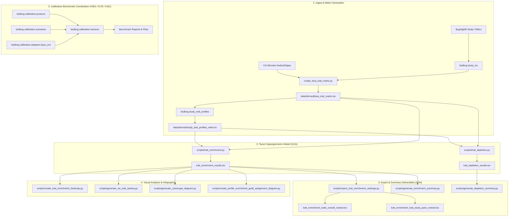

# Comprehensive Draft PR: Microbial Trait Profiling, Enrichment, Visualization & Calibration

## 1. Executive Summary & Branch Scope

This Pull Request brings together the end-to-end microbial trait profiling and over-representation analysis (ORA) pipeline on branch `enrichment-analysis-heatmap-cluster`. It standardizes the $2 \times 2$ taxon-level hypergeometric sampling model ([#131](plans/taxon_hypergeometric_model_plan.md:1)), delivers full ranked TSV export suites ([#254](scripts/export_trait_enrichment_rankings.py:1)), integrates production code with the synthetic calibration harness ([#263](src/bsdbng/calibration/harness.py:1)), and provides visualization pipelines (densified heatmaps, 6-trait grouped Sankeys, tripartite Cytoscape networks, and infographic diagrams).

---

## 2. Architectural Components on This Branch

---

## 3. Comprehensive File Inventory Across Branch

### 3.1 Core Package (`src/bsdbng/`)
- [`src/bsdbng/study_trait_profiles.py:193`](src/bsdbng/study_trait_profiles.py:193): Matrix aggregation supporting binary indicator presence ($k = \text{unique taxa with trait}$) and `taxa_count` ($N$).
- [`src/bsdbng/study_tsv.py`](src/bsdbng/study_tsv.py): Extraction of study metadata and taxa lists from YAML.
- [`src/bsdbng/taxa_trait_matrix.py`](src/bsdbng/taxa_trait_matrix.py): Graph traversal linking NCBITaxon concepts to KG-Microbe functional traits.
- [`src/bsdbng/calibration/protocol.py:1`](src/bsdbng/calibration/protocol.py:1): Protocol interfaces (`InferenceAdapter`, `MethodInferenceResult`, `CalibrationBenchmarkReport`).
- [`src/bsdbng/calibration/scenarios.py:1`](src/bsdbng/calibration/scenarios.py:1): Benchmark scenario generators (`null_uniform`, `spiked_true_positives`, `signature_size_variation`).
- [`src/bsdbng/calibration/metrics.py:1`](src/bsdbng/calibration/metrics.py:1): Formal evaluation metrics (Kolmogorov-Smirnov null uniformity, Empirical False Positive Rate, Recovery Power, Rank Correlation).
- [`src/bsdbng/calibration/harness.py:1`](src/bsdbng/calibration/harness.py:1): Harness engine executing multi-replicate benchmark simulations.
- [`src/bsdbng/calibration/adapters/ilyas_ora.py:12`](src/bsdbng/calibration/adapters/ilyas_ora.py:12): Production ORA adapter implementing the $2 \times 2$ hypergeometric model.

### 3.2 Pipeline Scripts (`scripts/`)
- [`scripts/trait_enrichment.py:314`](scripts/trait_enrichment.py:314): Enrichment inference with $2 \times 2$ taxon urn sampling and Benjamini-Hochberg FDR.
- [`scripts/trait_depletion.py:257`](scripts/trait_depletion.py:257): Depletion inference testing under-representation.
- [`scripts/export_trait_enrichment_rankings.py:1`](scripts/export_trait_enrichment_rankings.py:1): Standardized TSV exporter for ranked traits and study-trait pairs.
- [`scripts/generate_enrichment_summary.py:1`](scripts/generate_enrichment_summary.py:1) & [`scripts/generate_depletion_summary.py:1`](scripts/generate_depletion_summary.py:1): Text summaries and multi-panel publication infographics.
- [`scripts/create_trait_enrichment_heatmap.py:1`](scripts/create_trait_enrichment_heatmap.py:1): Clustered heatmap generation with filtering thresholds.
- [`scripts/generate_six_trait_sankey.py:1`](scripts/generate_six_trait_sankey.py:1): Direction-stratified grouped Sankey diagrams.
- [`scripts/generate_cytoscape_diagram.py:1`](scripts/generate_cytoscape_diagram.py:1): Tripartite network diagram.
- [`scripts/create_profile_enrichment_guild_assignment_diagram.py:1`](scripts/create_profile_enrichment_guild_assignment_diagram.py:1): End-to-end analytical workflow infographic.

### 3.3 Test Suites (`tests/`)
- [`tests/test_enrichment_pipeline.py:1`](tests/test_enrichment_pipeline.py:1): Verification of hypergeometric sampling mathematics, censoring bounds, and FDR propagation.
- [`tests/test_calibration_harness.py:1`](tests/test_calibration_harness.py:1): End-to-end calibration harness and metric validation.
- [`tests/test_study_trait_profiles.py:1`](tests/test_study_trait_profiles.py:1): Binary taxon counts and wide TSV profile integrity.
- [`tests/test_six_trait_sankey.py:1`](tests/test_six_trait_sankey.py:1), [`tests/test_cytoscape_diagram.py:1`](tests/test_cytoscape_diagram.py:1), [`tests/test_profile_enrichment_diagram.py:1`](tests/test_profile_enrichment_diagram.py:1): Visual diagram generation validation.

---

## 4. Integration Tweaks & Cross-Branch Merge Considerations

To ensure clean merging with `main` and other collaborator branches (specifically Noel's scoring/calibration work in #178 / #181):

1. **Decoupled Calibration Harness**:
   - The calibration harness (`src/bsdbng/calibration/`) is cleanly separated into pluggable adapters.
   - Noel's GSEA/scoring adapter can be dropped into [`src/bsdbng/calibration/adapters/`](src/bsdbng/calibration/adapters/) without any merge collisions with `ilyas_ora.py`.
2. **Deterministic File Headers & Pre-commit Compliance**:
   - All generated TSVs and reports adhere to non-conflicting `# Comment: Value` metadata headers.
   - Codebase conforms 100% to line length ($<100$ characters) and typing standards (`ruff` and `mypy` green).
3. **Reproducible Justfile Recipes**:
   - All workflows (`just analyze`, `just export-rankings`, `just calibrate`, `just workflow-diagram`) use isolated relative paths inside `data/derived/`.
