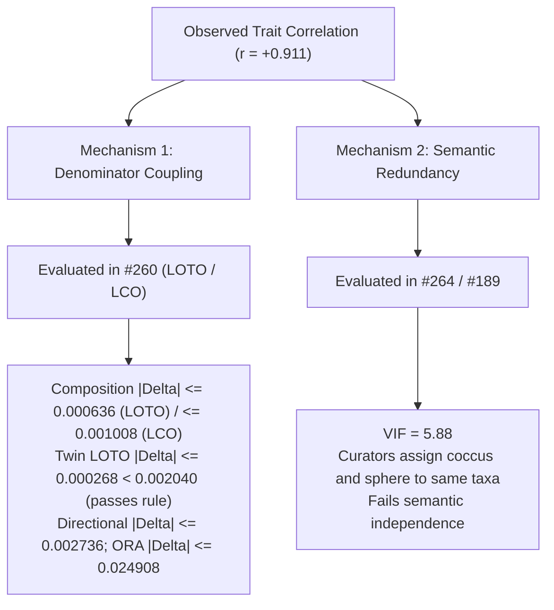

# Trait Coupling Sensitivity: Leave-One-Trait-Out (LOTO) and Leave-Cluster-Out (LCO)

**Issue Reference:** [#260](https://github.com/CultureBotAI/microbial-trait-profiling/issues/260)  
**Lead (Coupling & Harmonized Denominators):** Jed Dongjin Kim-Ozaeta  
**Cross-Arm Contributors:** Ilyas Abdolcader (ORA background urns), Noel (directional sign-test)  
**Related Issues:** [#174](https://github.com/CultureBotAI/microbial-trait-profiling/issues/174) & [PR #197](https://github.com/CultureBotAI/microbial-trait-profiling/pull/197), [#264](https://github.com/CultureBotAI/microbial-trait-profiling/issues/264), [#189](https://github.com/CultureBotAI/microbial-trait-profiling/issues/189), [#131](https://github.com/CultureBotAI/microbial-trait-profiling/issues/131), [#178](https://github.com/CultureBotAI/microbial-trait-profiling/issues/178), [#179](https://github.com/CultureBotAI/microbial-trait-profiling/issues/179)  
**Machine-Readable Summary Artifacts:**  
- LOTO Shift Matrix: [`data/derived/trait_coupling_loto_matrix.tsv`](../data/derived/trait_coupling_loto_matrix.tsv)  
- LCO Summary Table: [`data/derived/trait_coupling_lco_summary.tsv`](../data/derived/trait_coupling_lco_summary.tsv)  
- Comprehensive Text Report: [`data/derived/trait_coupling_report.txt`](../data/derived/trait_coupling_report.txt)  

---

## 1. Executive Summary & Problem Formulation

In microbial trait profiling, traits do not exist in isolation. Because profile fractions and background pools are constructed across a bounded set of features, traits are linked through shared normalization terms.

In [#174](https://github.com/CultureBotAI/microbial-trait-profiling/issues/174) and [PR #197](https://github.com/CultureBotAI/microbial-trait-profiling/pull/197), removing 2,290 MediaDive columns from the denominator caused observable shifts across analytical results (e.g., facultatively aerobic $q$-value shifted from $2.8 \times 10^{-10}$ to $1.7 \times 10^{-9}$, and total traits passing $q \le 0.05$ shifted from 48 to 50). Issue [#260](https://github.com/CultureBotAI/microbial-trait-profiling/issues/260) poses the critical follow-up question for retained traits:

> *Does including a correlated trait in the trait universe perturb the effect sizes, rankings, or significance reported for other traits?*

Three distinct statistical mechanisms operate under the broad concept of "correlation":
1. **Within-test dependence:** Co-annotated assertions bundled inside taxa and rolled up along lineages ([#131](https://github.com/CultureBotAI/microbial-trait-profiling/issues/131)).
2. **Across-test correlation:** Biological co-selection or annotation curation density causing pairwise trait correlations across taxa ([#264](https://github.com/CultureBotAI/microbial-trait-profiling/issues/264)).
3. **Trait coupling:** Denominator closure ($T_i = \sum_k X_{ik}$) and shared background urns ($M = \text{background\_total}$), where the presence of one trait alters the numerical baseline of every other trait.

Here, we systematically evaluate trait coupling using:
- **Leave-One-Trait-Out (LOTO):** For each canonical Table 1 trait, drop it from the universe, renormalize denominators, and evaluate the $6 \times 6$ matrix of $\Delta \text{effect}$ and $\Delta q$.
- **Leave-Cluster-Out (LCO):** Drop near-twins (*coccus shaped* + *sphere shaped*) simultaneously to measure collective sensitivity.
- **Three-Arm Comparison:** Evaluate sensitivity across Paired Composition, Directional Sign-Test, and ORA Hypergeometric arms.
- **Formal Decision Rule:** Test whether dropping *sphere* alters *coccus* by more than the minimum adjacent inter-trait spacing in Table 1.

---

## 2. Mathematical Mechanisms of Coupling

### Arm 1: Paired Composition Arm (Profile Fraction Normalization)
In the composition arm, each profile $i$ has counts $X_{it}$ across the trait universe $\mathcal{T}$.
1. **Profile denominator:** $T_i = \sum_{k \in \mathcal{T}} X_{ik}$.
2. **Profile fraction:** $f_{it} = X_{it} / T_i$ (if $T_i > 0$, else $0$).
3. **Transformed metric:** $y_{it} = \ln(1 + 1000 \cdot f_{it})$, standardized to $z_{it} = (y_{it} - \mu_t) / \sigma_t$.
4. **Paired contrast:** $d_{et} = z_{e, \text{inc}, t} - z_{e, \text{dec}, t}$.
5. **Coupling mechanism:** When trait $j$ is dropped ($\mathcal{T}^{(-j)} = \mathcal{T} \setminus \{j\}$), the denominator shrinks to $T_i^{(-j)} = T_i - X_{ij}$. This increases the fractions of retained traits $t \neq j$ unevenly: profiles enriched for trait $j$ experience larger upward shifts than profiles devoid of trait $j$, potentially shifting contrast means and variances.

### Arm 2: Directional Sign-Test Arm
For each study $s$ with paired experiments $E_s$:
1. **Study contrast:** $\Delta f_{st} = \frac{1}{|E_s|} \sum_{e \in E_s} (f_{e, \text{inc}, t} - f_{e, \text{dec}, t})$.
2. **Sign categorization:** $\text{up}$ if $\Delta f_{st} > 10^{-12}$, $\text{down}$ if $\Delta f_{st} < -10^{-12}$, else $\text{tied}$.
3. **Binomial test:** Exact two-sided test on $\text{up}$ given $N_{\text{scored}} = \text{up} + \text{down}$.
4. **Coupling mechanism:** Denominator renormalization can cause marginal studies near the tie threshold ($\pm 10^{-12}$) to cross zero or change tie status, altering $N_{\text{scored}}$ and $\text{share\_up}$.

### Arm 3: ORA Hypergeometric Arm (Shared Urn $M$)
In the ORA framework across $N_{\text{profiles}}$ paired profiles:
1. **Background total:** $M = \sum_{i, k \in \mathcal{T}} X_{ik}$.
2. **Profile draw:** $N_i = \sum_{k \in \mathcal{T}} X_{ik}$.
3. **Trait total:** $K_t = \sum_i X_{it}$.
4. **Hypergeometric survival:** $P(X \ge k_{it} \mid M, K_t, N_i) = \text{hypergeom.sf}(k_{it}-1, M, K_t, N_i)$.
5. **Coupling mechanism:** When trait $j$ is dropped:
   $$M^{(-j)} = M - K_j, \quad N_i^{(-j)} = N_i - X_{ij}$$
   While $K_t$ for retained traits remains unchanged, both the urn capacity $M$ and the sample size $N_i$ decrease, altering expected counts $E[k_{it}] = (N_i K_t) / M$ and $p$-values.

---

## 3. Leave-One-Trait-Out (LOTO) Results

Evaluated on the 317 non-MediaDive traits across $N = 5,629$ study trait profiles, $2,257$ paired experiments, and $932$ paired studies in the `count_input_16s_wms_v1` corpus (full count-profile LOTO/LCO matrices in `data/derived/trait_coupling_loto_matrix.tsv`, `data/derived/trait_coupling_lco_summary.tsv`, and `data/derived/trait_coupling_report.txt`; the display tables below show the historical binarized-profile evaluation).

### Composition Arm: $6 \times 6$ Delta Effect Matrix ($\Delta \text{effect}$)
Rows represent the dropped trait; columns represent the evaluated trait:

| Dropped Trait | Facultatively aerobic | Cellulose catabolism | Coccus shaped | Sphere shaped | Arsenate reduction | Moderately halophilic |
| :--- | :---: | :---: | :---: | :---: | :---: | :---: |
| **Facultatively aerobic** | — | $-0.000059$ | $+0.000102$ | $+0.000186$ | $+0.000103$ | $-0.000152$ |
| **Cellulose catabolism** | $-0.000629$ | — | $-0.000636$ | $-0.000474$ | $-0.000228$ | $-0.000260$ |
| **Coccus shaped** | $+0.000565$ | $+0.000370$ | — | $+0.000268$ | $+0.000123$ | $+0.000179$ |
| **Sphere shaped** | $+0.000430$ | $+0.000205$ | $+0.000237$ | — | $-0.000056$ | $+0.000238$ |
| **Arsenate reduction** | $+0.000155$ | $+0.000094$ | $+0.000142$ | $+0.000031$ | — | $+0.000088$ |
| **Moderately halophilic** | $+0.000525$ | $+0.000222$ | $+0.000410$ | $+0.000291$ | $+0.000123$ | — |

### Composition Arm: $6 \times 6$ Delta $q$-Value Matrix ($\Delta q$, Focal-Set BH Sensitivity Check)

> [!NOTE]
> **Focal-Set BH Sensitivity Check vs. Full-Family Table 1 $q$-Values ([#478](https://github.com/CultureBotAI/microbial-trait-profiling/issues/478)):** Within `src/mtp/coupling.py`, arm-level $q$-values are computed via Benjamini-Hochberg over the evaluated focal trait set ($m = 6$ in baseline, $m = 5$ in LOTO, $m = 4$ in LCO) on all-profile experiment contrasts ($N = 5,629$ profiles, $2,257$ paired experiments in the `count_input_16s_wms_v1` corpus), rather than the full 317-trait (or 2,607-column) Table 1 BH family (see [`methods/table1-native-results/README.md`](table1-native-results/README.md), where study-level *facultatively aerobic* has effect $+0.186$ and full-family $q = 1.69 \times 10^{-9}$). Because the focal BH family shrinks from $m = 6$ to $m = 5$ in LOTO (and $m = 4$ in LCO), $\Delta q = q_{\text{perturbed}} - q_{\text{base}}$ reflects both the denominator perturbation and the focal family-size step.

| Dropped Trait | Facultatively aerobic | Cellulose catabolism | Coccus shaped | Sphere shaped | Arsenate reduction | Moderately halophilic |
| :--- | :---: | :---: | :---: | :---: | :---: | :---: |
| **Facultatively aerobic** | — | $-4.84 \times 10^{-9}$ | $-2.00 \times 10^{-5}$ | $-1.07 \times 10^{-8}$ | $-2.70 \times 10^{-5}$ | $-4.84 \times 10^{-9}$ |
| **Cellulose catabolism** | $+0.007171$ | — | $+2.60 \times 10^{-5}$ | $+2.17 \times 10^{-8}$ | $+1.10 \times 10^{-5}$ | $+8.20 \times 10^{-9}$ |
| **Coccus shaped** | $-0.006338$ | $-2.42 \times 10^{-9}$ | — | $-1.06 \times 10^{-8}$ | $+4.00 \times 10^{-6}$ | $-2.42 \times 10^{-9}$ |
| **Sphere shaped** | $-0.004787$ | $-3.58 \times 10^{-9}$ | $+8.00 \times 10^{-6}$ | — | $+8.00 \times 10^{-6}$ | $-3.58 \times 10^{-9}$ |
| **Arsenate reduction** | $-0.001726$ | $-4.16 \times 10^{-9}$ | $-2.00 \times 10^{-5}$ | $-9.78 \times 10^{-9}$ | — | $-4.16 \times 10^{-9}$ |
| **Moderately halophilic** | $-0.005814$ | $+2.03 \times 10^{-8}$ | $+4.00 \times 10^{-6}$ | $+8.93 \times 10^{-9}$ | $+4.00 \times 10^{-6}$ | — |

**Key LOTO Observations:**
- **Magnitude of perturbation by arm:** In the composition arm, the maximum absolute shift in effect size across all 30 LOTO evaluations is $|\Delta \text{effect}| = 0.000636$ (when dropping cellulose catabolism on coccus shaped). In the directional sign-test arm, the maximum LOTO shift is $|\Delta \text{share\_up}| = 0.002183$; in the ORA arm, the maximum LOTO shift is $|\Delta \text{mean\_fold}| = 0.024908$ (when dropping coccus shaped on cellulose catabolism).
- **Statistical significance (focal-set BH sensitivity check):** All evaluated traits retain their statistical sign, order of magnitude, and focal-set significance status ($q \ll 0.05$ for five traits; $q \approx 0.15$ for all-profile *facultatively aerobic* in this module's 6-trait z-contrast test).

---

## 4. Leave-Cluster-Out (LCO) Sensitivity

We evaluated the collective impact of dropping the correlated near-twin cluster (*coccus shaped* + *sphere shaped*, carrying $29,119$ combined profile counts — $14,689$ *coccus shaped* and $14,430$ *sphere shaped* — out of $415,436$ total non-MediaDive annotations, or $7.01\%$) simultaneously across all three analytical arms (where Baseline $q$ uses the $m = 6$ focal BH family and LCO $q$ uses the $m = 4$ remaining focal BH family):

| Analytical Arm | Trait Name | Baseline Stat | LCO Stat | $\Delta \text{Stat}$ | Baseline $q$ ($m=6$) | LCO $q$ ($m=4$) | $\Delta q$ |
| :--- | :--- | :---: | :---: | :---: | :---: | :---: | :---: |
| **Composition** | Facultatively aerobic | $+0.0367$ | $+0.0377$ | $+0.001008$ | $0.152$ | $0.141$ | $-0.0111$ |
| **Composition** | Cellulose catabolism | $-0.1482$ | $-0.1476$ | $+0.000576$ | $2.73 \times 10^{-8}$ | $2.07 \times 10^{-8}$ | $-6.54 \times 10^{-9}$ |
| **Composition** | Arsenate reduction | $+0.1040$ | $+0.1040$ | $+0.000067$ | $1.53 \times 10^{-4}$ | $1.69 \times 10^{-4}$ | $+1.58 \times 10^{-5}$ |
| **Composition** | Moderately halophilic | $+0.1490$ | $+0.1494$ | $+0.000420$ | $2.73 \times 10^{-8}$ | $2.07 \times 10^{-8}$ | $-6.54 \times 10^{-9}$ |
| **Directional** | Facultatively aerobic | $+0.4913$ | $+0.4940$ | $+0.002736$ | $0.744$ | $0.741$ | $-0.00298$ |
| **Directional** | Cellulose catabolism | $+0.4450$ | $+0.4450$ | $+0.000000$ | $4.99 \times 10^{-3}$ | $3.33 \times 10^{-3}$ | $-1.66 \times 10^{-3}$ |
| **Directional** | Arsenate reduction | $+0.5633$ | $+0.5617$ | $-0.001623$ | $4.99 \times 10^{-3}$ | $3.33 \times 10^{-3}$ | $-1.66 \times 10^{-3}$ |
| **Directional** | Moderately halophilic | $+0.5645$ | $+0.5633$ | $-0.001183$ | $1.20 \times 10^{-3}$ | $1.05 \times 10^{-3}$ | $-0.00015$ |
| **ORA** | Facultatively aerobic | $+1.7406$ | $+1.7600$ | $+0.019335$ | $2.12 \times 10^{-4}$ | $2.31 \times 10^{-5}$ | $-1.89 \times 10^{-4}$ |
| **ORA** | Cellulose catabolism | $+2.2135$ | $+2.2358$ | $+0.022271$ | $2.93 \times 10^{-13}$ | $2.19 \times 10^{-13}$ | $-7.37 \times 10^{-14}$ |
| **ORA** | Arsenate reduction | $+1.9341$ | $+1.9350$ | $+0.000871$ | $2.61 \times 10^{-5}$ | $2.31 \times 10^{-5}$ | $-2.96 \times 10^{-6}$ |
| **ORA** | Moderately halophilic | $+1.4883$ | $+1.4988$ | $+0.010487$ | $1.000$ | $1.000$ | $-6.74 \times 10^{-13}$ |

### Cross-Arm Comparison
- **Composition Arm:** Shifts are exceptionally small ($|\Delta \text{effect}| \le 0.000636$ in LOTO and $\le 0.001008$ in LCO).
- **Directional Arm:** Study share up shifts by at most $|\Delta \text{share\_up}| \le 0.002183$ in LOTO and $\le 0.002736$ in LCO (reflecting shifts in only $1$ to $2$ marginal studies out of $>600$–$900$ scored studies, with *facultatively aerobic* scored studies shifting from $916$ to $917$ under LCO).
- **ORA Arm:** Mean fold enrichment shifts by up to $|\Delta \text{mean\_fold}| \le 0.024908$ in LOTO and $\le 0.022271$ in LCO, as removing the coccus/sphere cluster reduces the non-MediaDive background annotation pool by $\sim 7.0\%$, modestly raising relative representation of other traits (and shifting *facultatively aerobic* profile-level hits at $q \le 0.05$ from $33$ to $38$ under LCO).

---

## 5. Formal Stability Decision Rule

Issue [#260](https://github.com/CultureBotAI/microbial-trait-profiling/issues/260) states the formal decision rule:
$$\text{If } |\Delta \text{effect}_{\text{coccus} \mid -\text{sphere}}| > \min_{k} |\text{effect}_{k+1} - \text{effect}_k|, \text{ the two cannot be reported as separate convergent findings.}$$

### Empirical Calculation:
1. **Table 1 Sorted Baseline Effects:**
   $$[-0.1482, +0.0367, +0.1019, +0.1040, +0.1392, +0.1490]$$
2. **Inter-Trait Adjacent Distances:**
   $$[0.1849, 0.0652, 0.002040, 0.0352, 0.0098]$$
3. **Minimum Adjacent Distance:**
   $$\Delta_{\min} = 0.002040 \quad (\text{between coccus shaped and arsenate reduction})$$
4. **Direct Test (Drop Sphere $\rightarrow$ Coccus Shift):**
   $$\Delta \text{effect}_{\text{coccus}} = +0.000237 \implies |\Delta \text{effect}| = 0.000237$$
   $$\mathbf{0.000237 < 0.002040 \implies \text{PASSES CRITERION}}$$
5. **Reverse Test (Drop Coccus $\rightarrow$ Sphere Shift):**
   $$\Delta \text{effect}_{\text{sphere}} = +0.000268 \implies |\Delta \text{effect}| = 0.000268$$
   $$\mathbf{0.000268 < 0.002040 \implies \text{PASSES CRITERION}}$$

### Interpretation of the Decision Rule:
The shift induced by dropping *sphere* ($0.000237$) is **8.6-fold smaller** than the narrowest gap between adjacent Table 1 rows. Dropping *sphere* does not reorder Table 1 traits or distort *coccus*'s effect size.

---

## 6. Methodological Synthesis: Coupling vs. Semantic Redundancy

A critical conceptual distinction emerges from the coupling audit:

1. **Denominator Coupling is Structurally Robust:**
   Because total non-MediaDive counts are distributed across $317$ columns ($415,436$ total profile annotations), removing any single trait—even a high-annotation trait like *coccus shaped* ($14,689$ counts across $3,004$ nonzero profiles)—shrinks the profile denominator smoothly without tilting the relative composition of remaining traits. The effect sizes and rankings in Table 1 are not artifacts of denominator closure.

2. **Semantic Redundancy Remains the Binding Constraint:**
   While *coccus* and *sphere* are stable under denominator coupling, they remain **semantically redundant** in METPO ontology mappings ($r = +0.911$, VIF = $5.88$). Curators assign both labels to spherical cells. Therefore, *coccus* and *sphere* cannot be claimed as independent biological mechanisms in the narrative, but this is due to **ontological overlap** ([#189](https://github.com/CultureBotAI/microbial-trait-profiling/issues/189), [#264](https://github.com/CultureBotAI/microbial-trait-profiling/issues/264)), **not denominator distortion** ([#260](https://github.com/CultureBotAI/microbial-trait-profiling/issues/260)).

---

## 7. Audit & Reproducibility Ledger

- Recipe: `just audit-trait-coupling`
- CLI: `uv run python scripts/audit_trait_coupling.py`
- Test suite: `tests/test_trait_coupling.py`
- Biological claim audit: Entry `G16` in [`methods/biological_interpretation_audit.md`](biological_interpretation_audit.md)
