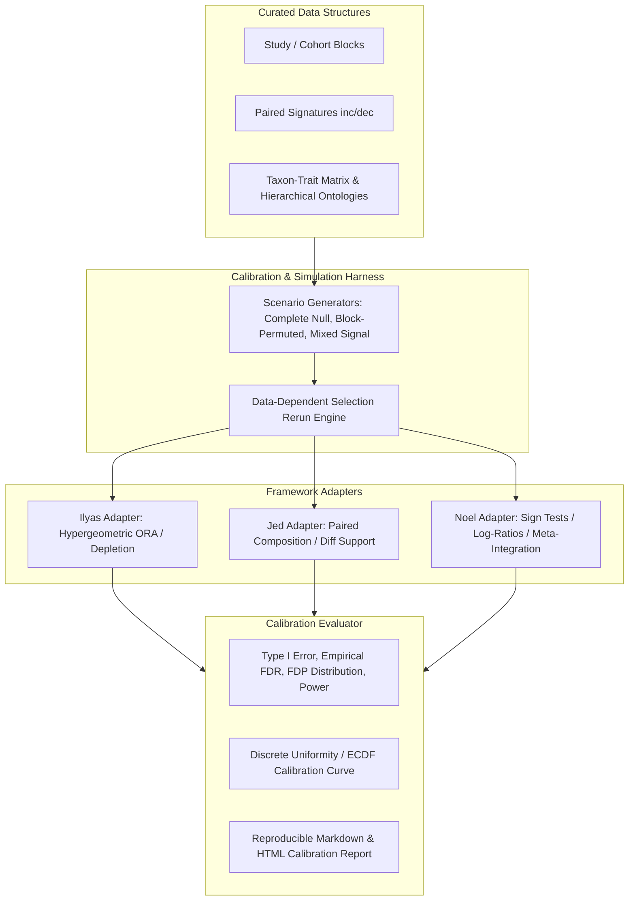

# Empirical Calibration & Simulation Framework for Multi-Method Microbial Trait Inference

## 1. Problem Framing & Theoretical Explanation

### 1.1 Why Numerical Tests & FDR Corrections Are Insufficient
In the current BugSigDB analysis pipeline, previous issues and tests (e.g. [#135](https://github.com/turbomam/bsdbng/issues/135), [#181](https://github.com/turbomam/bsdbng/issues/181)) verified that:
1. Formulas for hypergeometric survival functions, log-ratios, and paired differences are computed with correct arithmetic.
2. Standard Benjamini-Hochberg (BH) / Benjamini-Yekutieli (BY) procedures run over whatever $p$-value vectors are produced.

However, standard FDR controls (such as Benjamini-Hochberg) mathematically rely on **valid input $p$-values** that are uniformly distributed under the null hypothesis (or conservative/super-uniform, $P(p \le \alpha) \le \alpha$). When an entire pipeline involves:
- Corpus-dependent background estimation ($M, K(T)$),
- Filtering and selection of top traits/profiles before downstream testing (e.g., selection of six representative traits),
- Block-correlated annotation structures and hierarchical taxonomy ontology propagation,
- Unequal study/cohort replication and body-site imbalance,

the resulting pipeline $p$-values and post-selection inferences can become severely miscalibrated, anti-conservative ($P(p \le \alpha) \gg \alpha$), or conditionally biased.

### 1.2 Method-Specific Definitions: Nulls, Estimands, Units, and Assumptions

We strictly reject imposing a single common null hypothesis on the three distinct analytical frameworks. Each framework asks a distinct biological/statistical question over distinct independent units:

| Dimension | Framework 1: Ilyas (Taxon ORA / Hypergeometric Depletion & Enrichment) | Framework 2: Jed (Paired Composition / Differential Support) | Framework 3: Noel (Study Signs, Log-Ratios & Multi-Study Integration) |
|---|---|---|---|
| **Primary Estimand** | Over/under-representation of trait-bearing taxa in a signature profile relative to a background reference universe: $\text{Odds Ratio} = \frac{k / (N - k)}{(K - k) / (M - N - K + k)}$ | Paired directional shift in trait prevalence between matched increased (`inc`) and decreased (`dec`) signatures within the same experiment: $\Delta = p_{\text{inc}} - p_{\text{dec}}$ | Consistent cross-study directional log-ratio / sign consistency across independent studies: $\theta = \sum_{s} w_s \cdot \text{sgn}(\text{log-ratio}_s)$ |
| **Independent Sampling Unit** | Taxa reported within an experiment signature (conditioned on background universe $\mathcal{U}_{\text{bg}}$) | Paired experiment within a study cohort $(e_{\text{inc}}, e_{\text{dec}})$ | Independent Study ($S_i$) or Cohort |
| **Method Null Hypothesis ($H_0$)** | $H_0^{\text{ORA}}$: The taxa in profile $P$ are drawn uniformly at random without replacement from background universe $\mathcal{U}_{\text{bg}}$ regardless of trait $T$. | $H_0^{\text{Paired}}$: Trait presence/absence is conditionally exchangeable between the `inc` and `dec` arms of a paired experiment. | $H_0^{\text{Sign}}$: Cross-study effect directions are symmetric coin flips ($\Pr(\text{sgn} = +1) = 0.5$) with mean log-ratio $\mu = 0$. |
| **Eligible Population** | Profiles with valid signature size $N \ge N_{\min}$ and traits present in background ($K \ge K_{\min}$) | Experiments containing strictly paired $(e_{\text{inc}}, e_{\text{dec}})$ signatures with non-zero shared annotation coverage | Studies reporting the target condition/trait contrast with $\ge 1$ paired experiment |
| **Claimed Error Rate** | Per-profile and Family-Wise FDR over evaluated trait hypotheses | Per-experiment and Global FDR over paired differential trait shifts | Meta-analytic FDR / family error rate across integrated trait-condition associations |
| **Exchangeability & Resampling Rules** | Resample/permute taxa annotations across the fixed background universe preserving profile sizes $N$; **not** independent cell shuffling. | Swap `inc` $\leftrightarrow$ `dec` labels **within** paired experiment blocks $(e_{\text{inc}}, e_{\text{dec}})$. | Permute condition labels or flip direction signs at the study/cohort block level. |



---

## 2. Benchmark Simulation Scenarios

To avoid misleading calibration benchmarks, simulations will not shuffle matrix cells independently (which breaks biological trait correlation and taxon clustering). Instead, we specify four rigorous benchmark scenarios:

### Scenario 1: Complete Global Null ($H_0$ True Everywhere)
- **Mechanism**:
  - Preserve the exact empirical study-experiment hierarchy, signature sizes ($N$), and the full taxon-trait annotation matrix [`taxa_trait_matrix.tsv`](data/derived/taxa_trait_matrix.tsv).
  - For each signature, sample $N$ taxa uniformly at random without replacement from the empirical background universe $\mathcal{U}_{\text{bg}}$.
- **Expected Outcome**:
  - Across all traits and profiles, Type I error at nominal $\alpha$ must satisfy $\Pr(p \le \alpha) \le \alpha$.
  - Discrete ECDF should lie strictly on or below the diagonal line $y = x$.
  - Nominal FDR at $q = 0.05$ must yield empirical FDR = $0.0$.

### Scenario 2: Paired Null via Block-Preserving Direction Swaps
- **Mechanism**:
  - Keep empirical taxon signatures intact, but for each paired experiment $(e_{\text{inc}}, e_{\text{dec}})$, randomly assign directions with $\Pr(\text{swap}) = 0.5$.
- **Expected Outcome**:
  - Validates Jed's and Noel's paired/directional null hypotheses while preserving empirical signature composition, unequal experiment counts per study, and body-site distributions.

### Scenario 3: Mixed Signal with Known Ground Truth
- **Mechanism**:
  - Inject true enrichment/depletion signal into a predeclared subset of traits $\mathcal{T}_{\text{signal}}$ in specific conditions/studies (odds ratio $\ge 2.5$ or paired difference $\Delta \ge 0.30$).
  - Keep remaining traits $\mathcal{T}_{\text{null}}$ strictly under the null.
- **Expected Outcome**:
  - Evaluate False Discovery Proportion ($\text{FDP} = \frac{V}{\max(R, 1)}$) and ensure $\mathbb{E}[\text{FDP}] \le q_{\text{nominal}}$.
  - Measure true positive rate (Power) as a function of effect size and study sample count.

### Scenario 4: Post-Selection Re-Run Simulation (Six-Trait Family vs Full Selection)
- **Mechanism**:
  - Run the end-to-end data-dependent selection procedure inside every Monte Carlo replicate (re-estimating backgrounds, filtering, ranking, selecting top 6 traits).
  - Compare error rates against a fixed, pre-declared 6-trait family.
- **Expected Outcome**:
  - Quantify the selection bias ("winner's curse") and document the exact inflation factor when post-selection hypotheses are treated as pre-specified.

---

## 3. Calibration Harness Architecture

We will implement a modular Python package under [`src/bsdbng/calibration/`](src/bsdbng/calibration/):

```
src/bsdbng/calibration/
├── __init__.py
├── protocol.py             # Abstract Base Class / Protocol for Method Adapters
├── scenarios.py            # Synthetic & semi-synthetic null/mixed generators
├── metrics.py              # Type I error, Empirical FDR, FDP, ECDF, MC SE
├── harness.py              # Monte Carlo orchestration engine with fixed seeds
└── adapters/
    ├── __init__.py
    ├── ilyas_ora.py        # Adapter for scripts/trait_enrichment.py & trait_depletion.py
    ├── jed_composition.py  # Adapter for paired composition testing
    └── noel_integration.py # Adapter for study sign tests & log-ratio integration
```

### 3.1 Adapter Protocol Interface
Each method owner maintains their adapter conforming to a unified protocol:
```python
class MethodAdapter(Protocol):
    method_id: str
    owner: str
    target_null: str

    def run_inference(
        self,
        profiles_df: pd.DataFrame,
        taxa_matrix: pd.DataFrame,
        config: dict[str, Any],
    ) -> CalibrationResult:
        """Execute the end-to-end inference procedure on provided inputs.

        Returns DataFrame containing test_id, trait, p_value, adjusted_p_value,
        effect_size, and reject_null indicator.
        """
        ...
```

### 3.2 Evaluation Metrics & Monte Carlo Precision
For $B$ Monte Carlo replicates (default $B = 1000$ for report, $B = 50$ for CI fixtures):
- **Empirical Type I Error**: $\hat{\alpha} = \frac{1}{B} \sum_{b=1}^B \mathbf{1}[p_b \le \alpha]$ with Monte Carlo standard error $\text{SE}(\hat{\alpha}) = \sqrt{\frac{\hat{\alpha}(1 - \hat{\alpha})}{B}}$.
- **Empirical FDR / FDP**: $\text{FDP}_b = \frac{|\mathcal{T}_{\text{false positives}}|}{|\mathcal{T}_{\text{discoveries}}| \lor 1}$, $\widehat{\text{FDR}} = \frac{1}{B}\sum_{b=1}^B \text{FDP}_b$.
- **Discrete p-value ECDF**: Stepwise empirical cumulative distribution function against theoretical uniform bounds.

---

## 4. CI Regression Fixtures & Justfile Recipes

1. **Lightweight CI Regression Fixture** ([`tests/test_method_calibration.py`](tests/test_method_calibration.py)):
   - Runs deterministic, fast ($B = 25$, fixed seed `seed=42`) checks on miniaturized synthetic datasets.
   - Asserts that no method has severe anti-conservative bias under complete null ($\hat{\alpha} \le \alpha + 3\cdot\text{SE}$).
   - Verifies adapter contract compliance and runs seamlessly inside `just check`.

2. **Full Calibration Benchmark Recipe** in [`Justfile`](Justfile):
   - `just calibrate`: Runs full Monte Carlo simulation ($B = 1000$) across all scenarios.
   - Generates summary calibration report: `data/derived/calibration_report.md` and diagnostic ECDF curves `data/derived/calibration_ecdf_curves.png`.

---

## 5. Integration with Integrated Evidence Table (#178)

The calibration harness outputs structured metadata consumed directly by [#178](https://github.com/turbomam/bsdbng/issues/178):
- `method_id` & `method_version`
- `tested_null_hypothesis`
- `tested_level` (Taxon ORA, Paired Signature Shift, Multi-Study Integrated Sign)
- `fdr_correction_family` (Per-profile, Global-corpus, Predeclared-6-traits)
- `empirical_calibration_status` (`VALIDATED_CONSERVATIVE`, `VALIDATED_EXACT`, `UNVALIDATED_EXPLORATORY`, `SELECTION_BIASED`)

This ensures that exploratory findings or post-selection results are cleanly tagged and not presented as universal guarantees.
