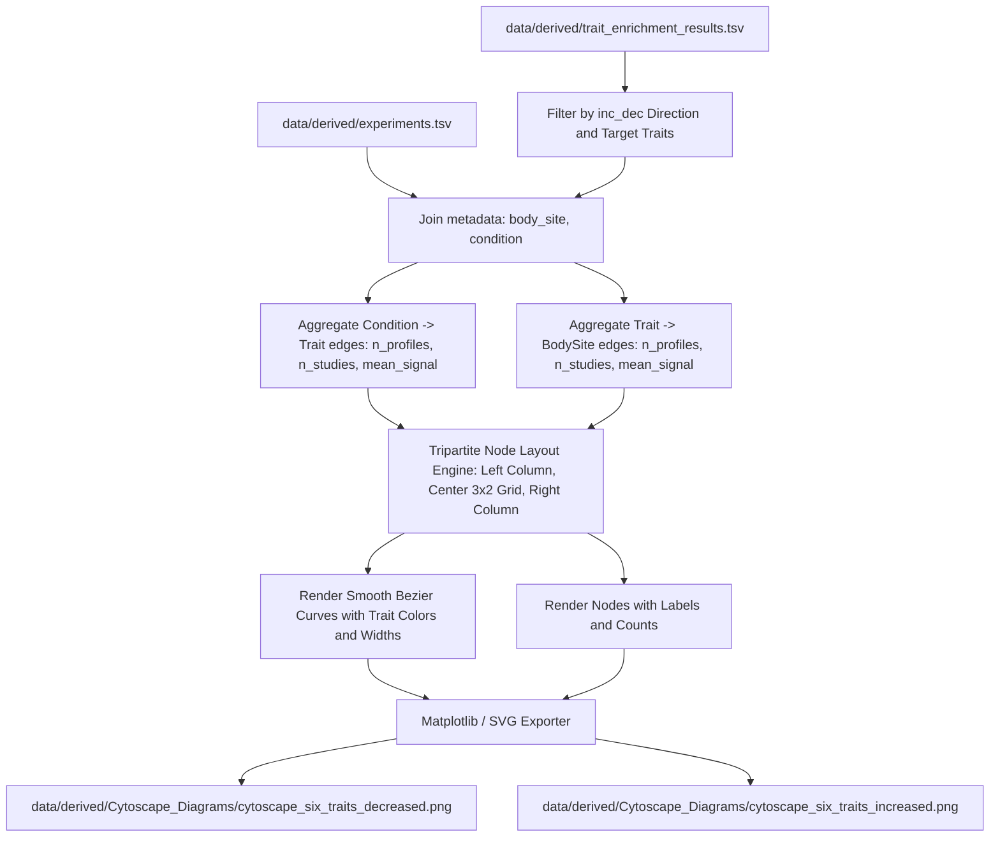

# Cytoscape-Inspired Tripartite Diagram Visualization Plan

This plan specifies the design and implementation for generating the **Cytoscape-inspired tripartite network diagram** based on the enrichment results from our BugSigDB enrichment pipeline, producing diagrams for both **decreased** and **increased** profiles.

---

## 1. Visual Specification & Image Analysis

The provided reference image (**"Six shared traits Cytoscape-inspired graph: decreased profiles"**) exhibits a tripartite graph layout with three column sections:

1. **Left Column (Condition Nodes):**
   - Individual conditions/diseases (e.g. *Parkinson's disease*, *Colorectal cancer*, *COVID-19*, *Asthma*, etc.) sorted by total signal/links descending.
   - Node glyphs: Pill/capsule or rounded horizontal ellipse shapes with light outline.
   - Node annotations: Condition label, `links=L, traits=T, n=N` (or studies count).
2. **Center Column (Six Trait Hubs):**
   - Placed in a $3 \times 2$ (or $2 \times 3$) centered grid layout.
   - Node glyphs: Large filled colored ellipses/capsules with distinct vibrant colors per trait and dark outlines.
   - Node annotations inside: Multi-line trait label (e.g. `facultatively aerobic`, `cellulose catabolic process`, `coccus shaped`, `sphere shaped`, `arsenate reduction`, `moderately halophilic`).
   - Node annotations below: `n=N` (total profile memberships) and `conditions=C, sites=S`.
3. **Right Column (Body-Site Nodes):**
   - High-level body site categories (e.g. *Feces*, *Vaginal / reproductive*, *Oral cavity / dental*, *Upper airway / nasal*, etc.) sorted by signal/links.
   - Node glyphs: Light pill/capsule shapes matching left column.
   - Node annotations: Body-site label, `links=L, traits=T, n=N`.
4. **Edges (Curved Ribbons / Bundled Bezier Curves):**
   - **Condition-to-Trait Edges:** Smooth cubic Bezier curves connecting condition nodes to the center trait hubs. Colored by the trait's assigned color.
   - **Trait-to-Body-Site Edges:** Smooth cubic Bezier curves connecting central trait hubs to target body site nodes. Colored by the trait's assigned color.
   - Edge widths: Scaled proportionally according to profile support ($n$ or unique profile count) with transparency (alpha blending).
   - Optional gray edges for non-enriched baseline background associations if desired.
5. **Legends & Headers:**
   - **Header Title & Subtitle:** Title indicating direction (e.g. *Six shared traits Cytoscape-inspired graph: decreased profiles* and *... increased profiles*) and methodological subtitle describing the nodes and edge aggregation.
   - **Footer Legend:** Showing sample edge widths (e.g., `edge n=3`, `edge n=13`, `edge n=226`) and trait color key.

---

## 2. Architecture & Data Flow



---

## 3. Implementation Details

### A. New Script: [`scripts/generate_cytoscape_diagram.py`](scripts/generate_cytoscape_diagram.py:1)
- Reads:
  - [`data/derived/trait_enrichment_results.tsv`](data/derived/trait_enrichment_results.tsv:1)
  - [`data/derived/experiments.tsv`](data/derived/experiments.tsv:1)
  - [`data/derived/taxa_trait_matrix_columns.tsv`](data/derived/taxa_trait_matrix_columns.tsv:1) / [`metpo_phenotype_mapping.tsv`](metpo_phenotype_mapping.tsv:1)
- Supports CLI arguments:
  - `--direction {inc,dec,both}` (default: `both`)
  - `--top-traits {6,auto}` or explicit trait list
  - `--min-profiles` (default: `2`)
  - `--min-studies` (default: `1`)
  - `--output-dir` (default: `data/derived/Cytoscape_Diagrams`)
- Generates both high-res `.png` (300 dpi) and scalable vector `.svg` outputs.

### B. Node Layout Algorithm:
- **Left Column ($X \approx 0.15$):** Condition nodes placed vertically with equidistant spacing, sized dynamically based on the number of qualifying conditions.
- **Center Hubs ($X \approx [0.45, 0.55]$, $Y \in [0.25, 0.50, 0.75]$):** 6 traits arranged in 2 columns $\times$ 3 rows.
- **Right Column ($X \approx 0.85$):** Grouped body site nodes placed vertically.

### C. Edge Routing:
- Condition $(x_c, y_c) \to$ Trait $(x_{t,\text{left}}, y_t)$: Cubic Bezier curve with horizontal control points.
- Trait $(x_{t,\text{right}}, y_t) \to$ Body Site $(x_b, y_b)$: Cubic Bezier curve with horizontal control points.
- Edge width: $w(n) = w_{\min} + (w_{\max} - w_{\min}) \cdot \sqrt{\frac{n - 1}{n_{\max} - 1}}$.

### D. Automated Testing:
- Create [`tests/test_cytoscape_diagram.py`](tests/test_cytoscape_diagram.py:1) validating:
  - Edge aggregation logic for condition-trait and trait-bodysite pairs.
  - Node coordinate layout calculation and non-overlapping center hubs.
  - End-to-end rendering for mock decreased and increased data.

### E. Justfile Integration:
- Add `cytoscape-diagram` recipe to [`Justfile`](Justfile:1):
  ```just
  cytoscape-diagram: analyze
  	just timed cytoscape-diagram "uv run python scripts/generate_cytoscape_diagram.py --direction both"
  ```
- Add `cytoscape-diagram` to the full `pipeline` recipe.

---

## 4. Verification & QA
- Run `just check` (`ruff`, `mypy`, `pytest`, `check-schema`, `security`).
- Execute `just cytoscape-diagram` to produce both `cytoscape_six_traits_decreased.png` and `cytoscape_six_traits_increased.png`.
- Inspect generated images to verify visual clarity, node labels, edge thickness scaling, and legend accuracy.
