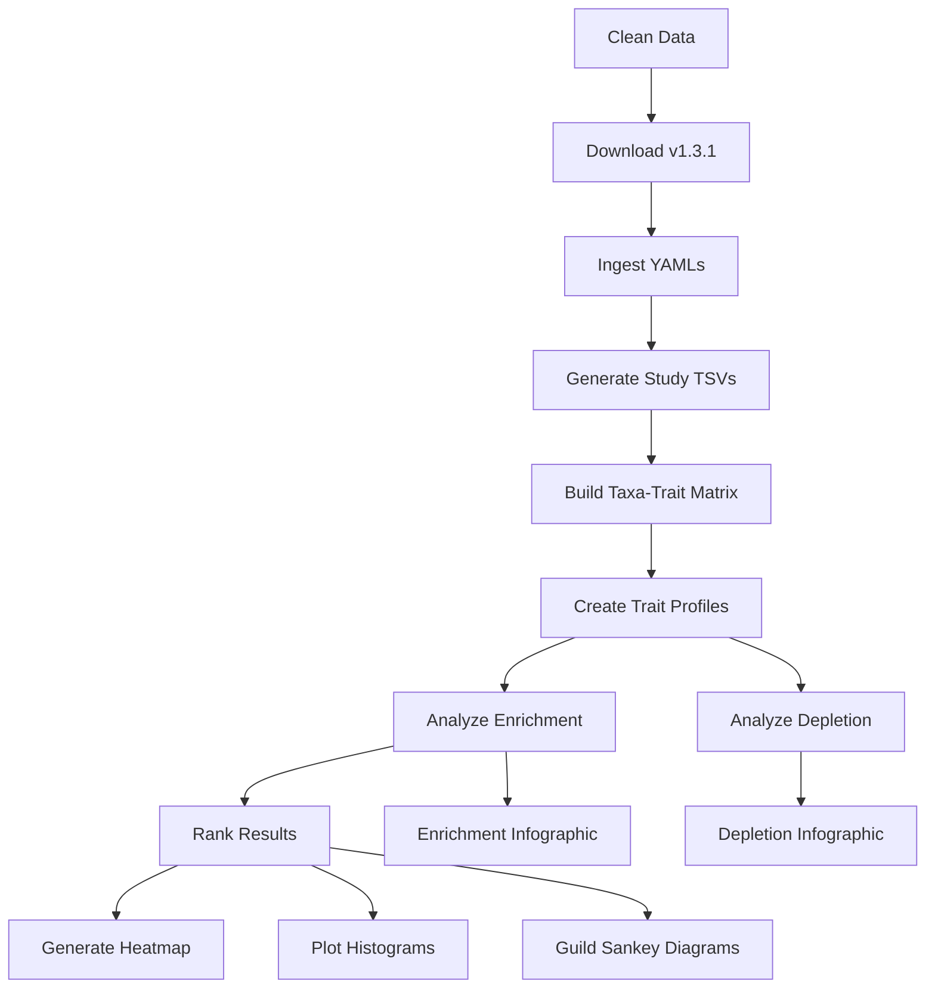

# Enrichment Pipeline Execution Plan (v1.3.1)

This plan outlines the steps to re-run the BugSigDB enrichment pipeline using exports from version 1.3.1 and regenerate all associated visualizations.

## Prerequisites
- Zenodo Record: `19740674` (BugSigDBExports v1.3.1)
- KG-Microbe data
- Default thresholds: $p < 0.001$, fold change $> 1.5$ (enrichment) and $< 0.5$ (depletion).

## Pipeline Workflow

### 1. Data Preparation
- **Clean**: Remove stale data from `data/raw/`, `data/studies/`, and `data/derived/`.
- **Download BugSigDB v1.3.1**: Fetch `full_dump.csv`, `studies.csv`, `experiments.csv`, and `signatures.csv` from Zenodo.
- **Download KG-Microbe**: Fetch trait metadata and edges.

### 2. Ingestion & Transformation
- **Ingest**: Parse CSVs into LinkML-compliant study YAMLs (filtering for *Homo sapiens*).
- **Study TSVs**: Flatten YAMLs into TSV format for downstream analysis.
- **Taxa-Trait Matrix**: Map BugSigDB taxa to KG-Microbe traits.
- **Study-Trait Profiles**: Create the binary presence/absence matrix of traits across studies.

### 3. Statistical Analysis
- **Trait Enrichment**: Run hypergeometric test for traits increased in cases vs controls.
- **Trait Depletion**: Run hypergeometric test for traits decreased in cases vs controls.
- **Rankings**: Generate ranked lists of trait-study pairs for visualization.

### 4. Visualization
- **Heatmaps**: Generate clustered heatmaps of enrichment results.
- **Histograms**: Plot distribution of enrichments across traits and profiles.
- **Sankey Diagrams**: Create guild-specific Sankey diagrams showing flow from condition to trait.
- **Infographics**: Generate summary PNGs for enrichment and depletion results.

## Mermaid Workflow Diagram

## Execution Order
The pipeline will be executed primarily using `just` recipes to ensure consistency.

1. `just clean-all`
2. `just download` (Note: ensure it pulls all necessary files for v1.3.1)
3. `just download-kg`
4. `just ingest`
5. `just taxa-trait-matrix`
6. `just study-trait-profiles`
7. `just analyze`
8. `just analyze-depletion`
9. `uv run python scripts/export_trait_enrichment_rankings.py ...`
10. `just genheatmap`
11. `just plot-histograms`
12. `uv run python scripts/generate_guild_sankey.py`
13. `just depletion-infographic`
14. `uv run python scripts/generate_enrichment_summary.py`
