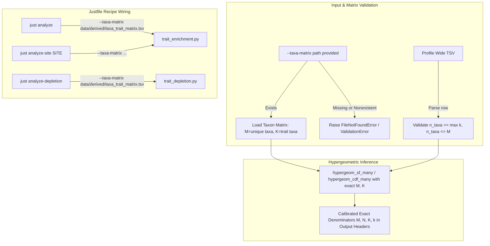

# Implementation Plan: Enforce Taxon Background Wiring, Strict Input Validation, and Calibration Documentation

## 1. Context & Architectural Overview

The goal of this issue is to address acceptance conditions for production Over-Representation Analysis (ORA) in `bsdbng`:
1. **Pass Defined Unique-Taxon Background**: Explicitly wire `--taxa-matrix data/derived/taxa_trait_matrix.tsv` in [`Justfile`](Justfile:144) (`analyze`, `analyze-depletion`, `analyze-site`) so that the standard commands do not omit it.
2. **Strict Validation & No Silent Fallback**: In [`scripts/trait_enrichment.py`](scripts/trait_enrichment.py:370) and [`scripts/trait_depletion.py`](scripts/trait_depletion.py:308), if `--taxa-matrix` is passed with a nonexistent or invalid path, fail immediately with an explicit error rather than silently falling back to summing profile occurrences. Validate profile draws ($N$) and background counts ($M, K$) such that invalid or missing inputs are rejected.
3. **Repeated-Taxon Fixture & Test**: Add a test fixture reproducing the exact repeated-taxon scenario (four unique taxa across two paired experiments) to verify that with the explicit unique-taxon background matrix $M=4$, $p=1/6$ rather than $M=8$, $p=0.2142857$.
4. **Calibration Documentation & Model Status**: Update documentation ([`docs/draft_pr_overview_and_merge_guide.md`](docs/draft_pr_overview_and_merge_guide.md:1), [`docs/milestone_taxon_model_before_after_summary.md`](docs/milestone_taxon_model_before_after_summary.md:1)) to explicitly note that binary presence alone does not establish exchangeability or independent sampling, that $p$-value direction bias depends on composition, and that the production model is pending full empirical calibration under #263 / #182.

---

## 2. Proposed Changes

### 2.1 Justfile
- In [`Justfile`](Justfile:144) recipe `analyze`: add `--taxa-matrix data/derived/taxa_trait_matrix.tsv` to [`scripts/trait_enrichment.py`](scripts/trait_enrichment.py:1).
- In [`Justfile`](Justfile:170) recipe `analyze-depletion`: add `--taxa-matrix data/derived/taxa_trait_matrix.tsv` to [`scripts/trait_depletion.py`](scripts/trait_depletion.py:1).
- In [`Justfile`](Justfile:189) recipe `analyze-site SITE`: add `--taxa-matrix data/derived/taxa_trait_matrix.tsv` (or site-filtered taxa matrix if applicable).

### 2.2 Strict Input Validation in `scripts/trait_enrichment.py` and `scripts/trait_depletion.py`
- If `args.taxa_matrix` is specified, verify `args.taxa_matrix.is_file()`. If it does not exist, raise `FileNotFoundError(f"Specified taxa matrix file does not exist: {args.taxa_matrix}")`.
- If `args.taxa_matrix` is empty or lacks rows, raise `ValueError("Taxa matrix file contains no valid taxa rows")`.
- Validate profile draws ($N$): verify $N > 0$ and $N \ge \max(k_{\text{observed}})$ for each profile. If $N > M$, raise a `ValueError` indicating draws exceed population size.
- Validate that $K(T) \le M$ for all traits.
- Add provenance headers into output TSVs: `# Taxa-Matrix-Source: <path>` or `# Background-Mode: TaxaMatrix` to ensure output provenance.

### 2.3 Repeated-Taxon Fixture in `tests/test_enrichment_pipeline.py`
- Add `test_repeated_taxon_fixture_background_wiring(tmp_path)`:
  - Create a fixture with 4 unique taxa in a taxa matrix (`Taxon1`, `Taxon2`, `Taxon3`, `Taxon4`), where `TraitA` is present in 2 of the 4 taxa ($K=2, M=4$).
  - Create profile TSV where 2 paired experiments have profiles drawing 2 taxa each ($N=2, k=1$).
  - Verify that running with `--taxa-matrix` reports $M=4$ and the exact expected $p$-value ($p = 1/6 \approx 0.1666667$).
  - Verify that running with a nonexistent matrix path raises an error and does not silently fall back.

### 2.4 Documentation Updates
- Update [`docs/draft_pr_overview_and_merge_guide.md`](docs/draft_pr_overview_and_merge_guide.md:1) and [`docs/milestone_taxon_model_before_after_summary.md`](docs/milestone_taxon_model_before_after_summary.md:1) to clarify:
  - Intended unique-taxon background definition and Justfile wiring.
  - Exchangeability caveats: binary presence does not guarantee independent sampling.
  - Production model completeness status is tied to the calibration battery (#263 / #182).
