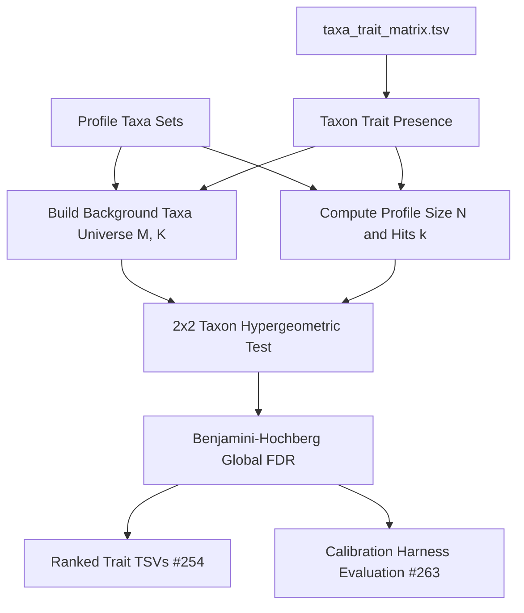

# Milestone Plan: Taxon Hypergeometric Model, Complete Exports & Calibration

## 1. Executive Summary & Goals

This plan narrows the next milestone to:
1. **[Issue #131](https://github.com/turbomam/bsdbng/issues/131)**: Standardizing the taxon-level hypergeometric sampling model with exact testable denominators ($M$, $K$, $N$, $k$) and formal background reference definition.
2. **[Issue #254](https://github.com/turbomam/bsdbng/issues/254)**: Delivering complete ranking exports (overall trait rankings, trait-study pairs, and condition breakdowns) in the standard workflow.
3. **[Issue #263](https://github.com/turbomam/bsdbng/issues/263)**: Coordinating calibration harness benchmarks using actual production code with Noel's methodology (#178 / #181).
4. **Pinned Results & PR Deliverable**: Regenerating derived results with before/after comparison and opening a draft PR on the linked branch.

---

## 2. Mathematical Formalization & Background Definitions (#131)

### 2.1 The 2x2 Taxon-Level Sampling Urn
For each trait $T$ evaluated in profile $P$:

| | Taxon Has Trait $T$ | Taxon Does NOT Have Trait $T$ | Total Taxa |
|---|---|---|---|
| **In Profile $P$ (Drawn)** | $k$ | $N - k$ | $N$ |
| **In Background Universe (Not in $P$)** | $K - k$ | $(M - N) - (K - k)$ | $M - N$ |
| **Total Universe (Background)** | $K$ | $M - K$ | $M$ |

Where:
- **$M$ (Background Population Size)**: Total unique taxa in the reference background universe $\mathcal{U}_{\text{bg}}$.
- **$N$ (Profile Sample Size)**: Total unique taxa reported in profile $P$ ($N = |U_P|$).
- **$K$ (Population Trait Hits)**: Total unique taxa in $\mathcal{U}_{\text{bg}}$ possessing trait $T$ ($K = \sum_{t \in \mathcal{U}_{\text{bg}}} \mathbf{1}[C(t, T) > 0]$).
- **$k$ (Observed Trait Hits)**: Number of unique taxa in profile $P$ possessing trait $T$ ($k = \sum_{t \in U_P} \mathbf{1}[C(t, T) > 0]$).

### 2.2 Expected Counts & P-Values
- **Expected Hits**: $\mathbb{E}[k] = N \times \frac{K}{M}$
- **Fold**: $\text{Fold} = \frac{k}{\mathbb{E}[k]} = \frac{k / N}{K / M}$
- **Enrichment P-value**: $p_{\text{enrich}} = \text{hypergeom.sf}(k - 1, M, K, N)$
- **Depletion P-value**: $p_{\text{deplete}} = \text{hypergeom.cdf}(k, M, K, N)$

### 2.3 Background Reference Options
1. **Global Study Universe (Default)**: All unique taxa reported across all testable profiles in BugSigDB ($\mathcal{U}_{\text{bg}} = \bigcup_{P \in \mathcal{P}_{\text{testable}}} U_P$).
2. **Matrix Universe**: All taxa present in [`data/derived/taxa_trait_matrix.tsv`](data/derived/taxa_trait_matrix.tsv).
3. **Stratified Body-Site Background**: Taxa restricted to specific anatomical sites (e.g., Feces / Gut).

---

## 3. Step-by-Step Implementation Strategy

### Step 1: Core Taxon Model & Background Pipeline (#131)
- Verify [`src/bsdbng/study_trait_profiles.py:193`](src/bsdbng/study_trait_profiles.py:193) outputs binary-count taxon matrices by default.
- Standardize [`scripts/trait_enrichment.py:314`](scripts/trait_enrichment.py:314) and [`scripts/trait_depletion.py:257`](scripts/trait_depletion.py:257) with explicit denominator logging:
  - Output `# Total-Taxa-Universe-M: <M>`
  - Output `# Total-Testable-Profiles: 
`
  - Explicit taxon counts per profile row ($N$).

### Step 2: Complete Exports & Summaries (#254)
- Ensure [`scripts/export_trait_enrichment_rankings.py`](scripts/export_trait_enrichment_rankings.py) processes the taxon model results without zero-division or degenerate $p$-values.
- Generate overall trait rankings and trait-study pairs across both $p < 0.001$ and FDR $q < 0.05$ regimes.
- Generate depletion rankings via [`scripts/generate_depletion_summary.py`](scripts/generate_depletion_summary.py).

### Step 3: Production Code Calibration Coordination (#263)
- Wire [`src/bsdbng/calibration/adapters/ilyas_ora.py`](src/bsdbng/calibration/adapters/ilyas_ora.py) to use identical denominator extraction and data structures from production [`src/bsdbng/study_trait_profiles.py`](src/bsdbng/study_trait_profiles.py).
- Verify synthetic benchmarks (null uniform, spiked true positive recovery, power curves) execute seamlessly through `Justfile` recipe.

### Step 4: Unit & Integration Testing
- Add unit tests for specific $2 \times 2$ analytical hypergeometric edge cases in [`tests/test_enrichment_pipeline.py`](tests/test_enrichment_pipeline.py).
- Test calibration protocol in [`tests/test_calibration_harness.py`](tests/test_calibration_harness.py).

### Step 5: Pinned Results Regeneration & Draft PR
- Run standard Justfile pipeline recipes to generate fresh derived tables.
- Document Before vs. After results comparison summary (assertion inflation vs. taxon sampling).
- Run full suite `just check` to ensure green lint/typecheck/tests.
- Prepare draft PR branch details.

---

## 4. Before / After Comparison Matrix

| Metric / Aspect | Previous Assertion-Count Model | Taxon-Level Sampling Model (#131) |
|---|---|---|
| **Population Draw Unit** | Trait assertion instances across all annotations | Distinct taxon carrying trait ($0$ or $1$) |
| **Profile Size ($N$)** | $\sim 24,000$ assertion sums | $\sim 10 - 80$ unique taxa per profile |
| **Universe Size ($M$)** | $\sim 500,000$ total assertions | $\sim 2,500$ unique taxa in BugSigDB |
| **$p$-value behavior** | Degenerate $0.0$ on modest fold enrichments | Calibrated probabilities reflecting true taxon sample sizes |
| **FDR BH Correction** | Skewed by tied zero $p$-values | Granular, ranked distribution |
| **Downstream Calibration** | Diverged from gene-set / ORA standard | Directly comparable with Noel's methods (#178 / #181) |
