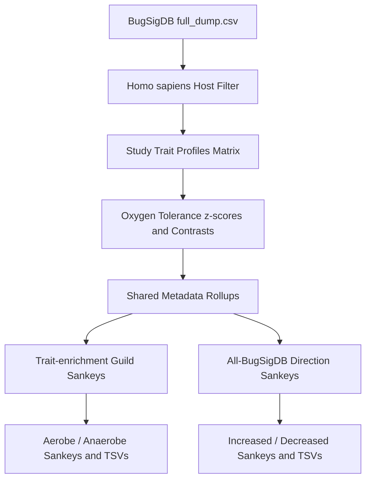

# Architecture Plan: BugSigDB to Trait-Enrichment Sankey Workflow Diagram

This document details the design and implementation plan for generating a high-resolution, vector-crisp workflow infographic script: [`scripts/create_profile_enrichment_guild_assignment_diagram.py`](scripts/create_profile_enrichment_guild_assignment_diagram.py) that produces PNG and SVG outputs matching the reference workflow graphic.

---

## 1. Overview & Visual Architecture

The target graphic summarizes the end-to-end transformation from raw BugSigDB exports to trait-enrichment Sankey diagrams.

### Layout Structure (Vertical Flow)
1. **Header Section**:
   - Title: **BugSigDB data to trait-enrichment Sankey diagrams** (bold, dark navy `#1a2b49`).
   - Subtitle: Source attribution, Zenodo DOI, and sample cohort filter summary.
2. **Top Sequence: 5 Step Cards (Horizontal Process Bar)**:
   - **Step 1 (Dark Blue/Gray)**: BugSigDB data (v1.3.1 full dump, parsed studies, host filter).
   - **Step 2 (Mint/Aqua)**: Trait profiles (study/experiment/direction profiles × KG-Microbe trait columns).
   - **Step 3 (Gold/Yellow)**: Guild enrichment (oxygen-tolerance mean z-scores, direction contrast).
   - **Step 4 (Blue/Lavender)**: Sankey tables (aggregate condition-to-body-site edges, v3 display rollups, audit TSVs).
   - **Step 5 (Coral/Red)**: Sankey diagrams (curved flow lines, width by profile support, color coding).
   - Discrete arrow connectors between cards.
3. **Midsection: Two-Branch Architecture**:
   - Section subheader: *"The workflow branches into two Sankey products after shared metadata rollups."*
   - Two large side-by-side cards:
     - **Branch A (Trait-enrichment guild Sankeys)** (Blue highlight): Description, output list items with styled badge pills, and an embedded mini-Sankey vector glyph with ribbon links.
     - **Branch B (All-BugSigDB direction Sankeys)** (Cool gray/slate highlight): Description, output list items, and an embedded mini-Sankey vector glyph with comparator ribbon links.
4. **Bottom Sequence: 4 Shared Infrastructure Cards**:
   - **Shared profile metadata** (counts of profiles, experiments, conditions, raw body sites).
   - **Trait-score matrix** (profile dimensions, selected traits, column z-scores of log1p fractions).
   - **Statistical methods** (matched inc-dec pairs, one-sample t-tests against zero, BH q-values).
   - **Display rollups** (`sankey_v3_rollups.py`, label grouping wrappers, legends).
5. **Footer**:
   - Reproducibility notice referencing script name.

---

## 2. Technical Implementation Specifications

### Output Formats & Rendering Engine
- **Tooling**: Matplotlib (`matplotlib.pyplot`, `matplotlib.patches`, `matplotlib.path.Path`).
- **Aspect Ratio & Sizing**: Canvas dimensions $32 \times 18$ inches (or $16:9$ wide landscape layout), saved at 300 DPI for PNG and clean scalable vector SVG.
- **Rendering Elements**:
  - `FancyBboxPatch` with rounded corners (`boxstyle="round,pad=...,rounding_size=..."`) for cards and badge pills.
  - Custom cubic Bézier ribbons (`MplPath`) for the mini-Sankey glyphs.
  - Step counter circles (`Circle` patch) with white bold numbering.
  - Right-pointing triangle markers/arrows for flow linkages.

### Color Palette Specification
- Background canvas: `#f8fafc` (off-white / slate 50)
- Card backgrounds:
  - Step 1: `#f0f7ff` (border: `#bcd8f5`, badge: `#1e3a8a`)
  - Step 2: `#f0fdf4` (border: `#86efac`, badge: `#166534`)
  - Step 3: `#fefce8` (border: `#fde047`, badge: `#854d0e`)
  - Step 4: `#eff6ff` (border: `#93c5fd`, badge: `#1d4ed8`)
  - Step 5: `#fff1f2` (border: `#fca5a5`, badge: `#9f1239`)
- Branch cards:
  - Guild Branch: Fill `#f0f7ff`, border `#93c5fd`, text title `#1d4ed8`
  - Direction Branch: Fill `#f8fafc`, border `#cbd5e1`, text title `#0f172a`
- Bottom Cards: Fill `#ffffff`, border `#e2e8f0`

---

## 3. Dynamic / Configurable Data Flow

The script will be parameterized to either:
1. Accept dynamic statistics computed on-the-fly from available `data/derived/` matrices if present.
2. Fall back to canonical published summary values (5,829 human profiles, 1,080 studies, 3,494 experiments, 365 conditions, 140 raw body sites, 60 traits, 2,335 pairs) to ensure guaranteed standalone reproducibility.

---

## 4. Workflow Diagram (Mermaid)



---

## 5. Testing & Validation (`tests/test_profile_enrichment_diagram.py`)

- **Rendering test**: Execute the script on mock/canonical data and verify both output `.png` and `.svg` files are created and non-empty.
- **SVG Structure validation**: Parse SVG XML output to confirm expected structural elements (rectangles, paths, text labels).
- **CLI Interface**: Verify `--output-png` and `--output-svg` arguments function as intended.

---

## 6. Justfile Recipe Integration

Add recipes to [`Justfile`](Justfile:1):
```just
# Generate the profile enrichment guild assignment workflow infographic diagram
workflow-diagram:
	uv run python scripts/create_profile_enrichment_guild_assignment_diagram.py
```
