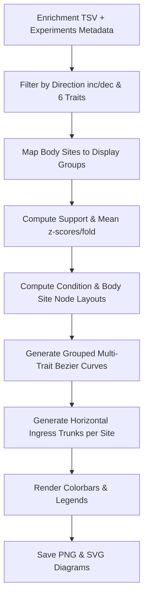

# Six-Trait Grouped Sankey Visualization Plan

This document details the architecture and implementation design for generating the grouped six-trait Sankey diagrams inspired by the reference figure, for both **decreased** and **increased** profiles from our BugSigDB enrichment pipeline.

---

## 1. Overview & Reference Figure Decomposition

The reference figure exhibits:
1. **Source Nodes (Left - Individual Conditions):**
   - Individual disease/condition names (e.g. *Parkinson's disease*, *Colorectal cancer*, *COVID-19*, *Human papilloma virus infection*, etc.).
   - Node annotations: Condition label, count of links ($links=L$), distinct traits involved ($traits=T$), and total positive-z / enriched profile count ($n=N$).
   - Node visual: Light circular or rounded node glyphs.
2. **Target Nodes (Right - Grouped Body Sites):**
   - Anatomical group categories (e.g. *Feces*, *Vaginal / reproductive*, *Oral cavity / dental*, *Upper airway / nasal*, *Lower GI tract*, *Stomach / esophagus*, *Ocular / eye*, *Birth-associated samples*, *Lower airway / lung*, *Skin*, *Intestinal / GI mucosa*).
   - Node annotations: Grouped site label, links count, traits count, total $n$.
3. **Edges (Parallel Multi-Trait Ribbons / Bezier Flows):**
   - Parallel curves for the 6 traits connecting condition to body site.
   - Curves ordered thick-to-thin within each condition/body-site stack.
   - Distinct color hues per trait (6 distinct colors).
   - Ribbon shade / opacity mapped to mean positive z-score or mean fold change ($\bar{z}$ or $\bar{\text{fold}}$) on a shared numeric scale.
   - Optional gray underlay / background links for non-enriched baseline profiles ($z \le 0$ or non-enriched).
   - Body-site trunks (horizontal segmented ribbons entering target nodes) sum same-color links.
4. **Legends & Sidebars:**
   - 6 trait color scales on the right (shared numeric scale $0 \to z_{\max}$ / fold).
   - Bottom legend for edge width ($n=3$ profiles, $n=10$ profiles, $n=67$ profiles, body-site trunk, background profiles).
   - Descriptive header and methodological footer notes.

---

## 2. Six Traits Selection Strategy

We will support selecting the top 6 most prevalent / significant traits dynamically or supplying custom trait sets (e.g. matching the reference: *facultatively aerobic*, *cellulose catabolic process*, *coccus shaped*, *sphere shaped*, *arsenate reduction*, *moderately halophilic*):

### Top Candidate Traits in our Pipeline:
- **Decreased Profiles (`dec`):**
  1. `METPO:1000608` (*facultatively aerobic*)
  2. `METPO:2000103|GO:0030245` (*cellulose catabolic process*)
  3. `METPO:1000668` (*coccus shaped*)
  4. `METPO:1000683` (*sphere shaped*)
  5. `METPO:2000103|pathways:arsenate_reduction` (*arsenate reduction*)
  6. `METPO:1000623` (*moderately halophilic*)
  *(or auto-ranked by top hit frequency across all conditions for `dec`)*

- **Increased Profiles (`inc`):**
  - Auto-ranked top 6 traits for increased signatures (or customizable via CLI/config).

---

## 3. Data Processing & Body Site Taxonomy Grouping

We map raw BugSigDB body sites into high-level anatomical display groups:

| High-Level Display Group | Raw BugSigDB Body Sites Included |
| :--- | :--- |
| **Feces** | Feces, Stool |
| **Oral cavity / dental** | Saliva, Oral cavity, Tongue, Dental plaque, Pharynx, Oropharynx, Gingival sulcus, Subgingival |
| **Vaginal / reproductive** | Vagina, Cervix, Cervicovaginal, Endometrium, Semen, Penis |
| **Upper airway / nasal** | Nasal cavity, Nasopharynx, Throat, Nose, Upper respiratory tract |
| **Lower GI tract** | Colon, Duodenum, Ileum, Rectum, Intestine, Cecum, Small intestine |
| **Stomach / esophagus** | Stomach, Gastric mucosa, Esophagus |
| **Ocular / eye** | Eye, Conjunctiva, Tear film, Ocular surface |
| **Birth-associated samples** | Meconium, Placenta, Amniotic fluid, Breast milk, Umbilical cord blood |
| **Lower airway / lung** | Lung, Bronchus, Lower respiratory tract, Sputum |
| **Skin** | Skin, Scalp, Forehead |
| **Intestinal / GI mucosa** | Colonic mucosa, Duodenal mucosa, Intestinal mucosa |

### Support Filtering Thresholds:
- $N \ge 3$ profiles and $S \ge 2$ studies per (condition, body-site, trait) ribbon.

---

## 4. Visualization Architecture & Generator Design

To reproduce the exact layout (parallel grouped Bezier ribbons with color scales, multi-colored node entry trunks, and annotation typography), we will implement a dedicated high-fidelity SVG/Matplotlib renderer in [`scripts/generate_six_trait_sankey.py`](scripts/generate_six_trait_sankey.py:1):



### Script Outputs:
1. `data/derived/Sankey_Diagrams/six_trait_sankey_decreased.png` (& `.svg`)
2. `data/derived/Sankey_Diagrams/six_trait_sankey_increased.png` (& `.svg`)

---

## 5. Implementation Steps & Justfile Integration

1. Create [`scripts/generate_six_trait_sankey.py`](scripts/generate_six_trait_sankey.py:1).
2. Add CLI flags (`--direction inc/dec/both`, `--top-traits 6`, `--min-profiles 3`, `--min-studies 2`).
3. Add recipe to [`Justfile`](Justfile:1):
   ```just
   six-trait-sankey: analyze
       uv run python scripts/generate_six_trait_sankey.py --direction both
   ```
4. Add unit / regression tests in `tests/test_sankey.py` to verify pipeline output.
