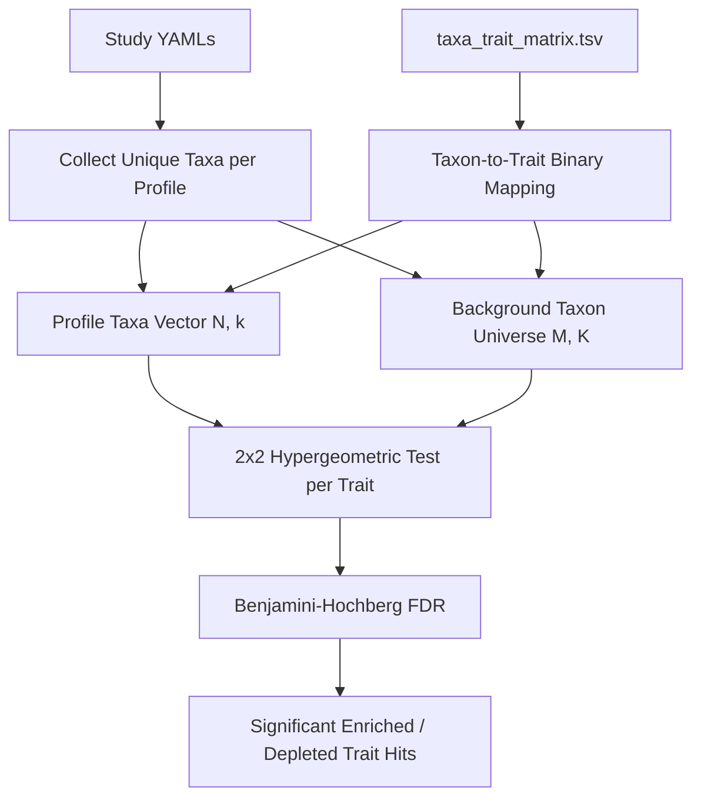

# Architecture Plan: Taxon-Level Hypergeometric Sampling Model Repair

## 1. Problem Statement & Mathematical Diagnosis

### 1.1 The Existing Assertion-Count Model (Defect)
In the current implementation ([`scripts/trait_enrichment.py:308-375`](scripts/trait_enrichment.py:308) and [`scripts/trait_depletion.py:252-325`](scripts/trait_depletion.py:252)):
- Profile rows are generated by summing assertion count vectors from [`src/bsdbng/study_trait_profiles.py:193-212`](src/bsdbng/study_trait_profiles.py:193).
- In [`scripts/trait_enrichment.py`](scripts/trait_enrichment.py:314), the hypergeometric urn parameters are defined across assertion counts:
  - $M = \text{background\_total} = \sum_{\text{all profiles}} \sum_{\text{all traits}} \text{count}(\text{profile}, \text{trait})$
  - $N = \text{row\_total} = \sum_{\text{all traits}} \text{count}(\text{profile}, \text{trait})$
  - $K = \text{trait\_total} = \sum_{\text{all profiles}} \text{count}(\text{profile}, \text{trait})$
  - $k = \text{count}(\text{profile}, \text{trait})$
- **Failure mechanism:**
  1. The urn treats every *taxon-trait assertion* (and descendant propagation) as an independent draw from the total pool of assertions across all profiles and traits.
  2. Because each taxon participates in dozens of trait assertions (and hierarchical propagation replicates genus/family traits to species), $N$ and $M$ are inflated by orders of magnitude (e.g. $N \sim 24,000$ instead of $N \sim 30$ taxa).
  3. Consequently, modest fold enrichments (e.g., fold 2.9) produce degenerate $p$-values of literal $0.0$, distorting Benjamini-Hochberg ranking and FDR thresholds.

---

## 2. The Taxon-Level 2×2 Hypergeometric Sampling Model

### 2.1 The Per-Trait Contingency Table
For each trait $T$, we define a $2 \times 2$ contingency table over **taxa**:

| | Taxon Has Trait $T$ | Taxon Does NOT Have Trait $T$ | Total Taxa |
|---|---|---|---|
| **In Profile (Drawn)** | $k$ | $N - k$ | $N$ |
| **In Background (Not in Profile)** | $K - k$ | $(M - N) - (K - k)$ | $M - N$ |
| **Total Universe (Background)** | $K$ | $M - K$ | $M$ |

Where:
- **$M$ (Population Size)**: Total number of unique taxa in the reference background universe (e.g., all unique taxa across all testable BugSigDB profiles, or the full curated taxonomy matrix universe).
- **$N$ (Sample Draws)**: Total number of unique taxa reported in the specific profile under test.
- **$K$ (Population Successes)**: Total number of unique taxa in the reference background universe that possess trait $T$ (binary presence: trait count $\ge 1$).
- **$k$ (Sample Successes)**: Number of unique taxa in the profile that possess trait $T$ (binary presence: trait count $\ge 1$).

### 2.2 Expected Count & Fold Calculation
- Expected taxa carrying trait $T$ under the null:
  $$\mathbb{E}[k] = N \times \frac{K}{M}$$
- Fold enrichment:
  $$\text{Fold} = \frac{k}{\mathbb{E}[k]} = \frac{k / N}{K / M}$$

### 2.3 Statistical Tests
- **Enrichment ($P[X \ge k]$)**:
  $$p_{\text{enrich}} = \text{hypergeom.sf}(k - 1, M, K, N)$$
- **Depletion ($P[X \le k]$)**:
  $$p_{\text{deplete}} = \text{hypergeom.cdf}(k, M, K, N)$$

---

## 3. Reference Background & Exchangeability Formulation

1. **Profile-Level Binary Indicator**:
   - For a profile $P$ with unique taxa $U_P = \{t_1, \dots, t_n\}$, a taxon $t_i$ has trait $T$ if $C(t_i, T) > 0$ (from [`data/derived/taxa_trait_matrix.tsv`](data/derived/taxa_trait_matrix.tsv)).
   - Profile-level trait count is $k(P, T) = \sum_{t \in U_P} \mathbf{1}[C(t, T) > 0]$.
   - Profile sample size is $N(P) = |U_P|$ (or $|U_P \cap \text{MatrixTaxa}|$).
2. **Background Universe Specification ($M$ and $K$)**:
   - Let $\mathcal{U}_{\text{bg}} = \bigcup_{P \in \mathcal{P}_{\text{testable}}} U_P$ be the set of unique taxa across all testable BugSigDB paired profiles (or alternatively, all taxa present in [`taxa_trait_matrix.tsv`](data/derived/taxa_trait_matrix.tsv)).
   - $M = |\mathcal{U}_{\text{bg}}|$.
   - $K(T) = \sum_{t \in \mathcal{U}_{\text{bg}}} \mathbf{1}[C(t, T) > 0]$.
   - *Note on Exchangeability & Alternatives:* By default, the reference universe is the set of all unique reported taxa evaluated across the dataset (empirical study background). For site-stratified analyses (e.g. Feces), $M_{\text{site}}$ and $K_{\text{site}}(T)$ are computed over taxa reported in that site cohort.
3. **Audit Metrics (Non-Conflated Quantification)**:
   As specified in triage, we distinguish and report:
   - Reported taxa count per profile ($N_{\text{reported}}$).
   - Contributing descendant taxa count (if resolving subtree expansion).
   - Annotation multiplicity (total assertions / unique taxa with annotations).

---

## 4. Implementation Plan & Affected Components

### 4.1 Study Trait Profiles Representation
- **Option A (Binary Profile Matrix)**: Ensure [`create_study_trait_profiles.py`](scripts/create_study_trait_profiles.py) / [`src/bsdbng/study_trait_profiles.py`](src/bsdbng/study_trait_profiles.py) aggregates unique taxa presence per trait ($k = \text{count of taxa with trait}$) or provide a binary / count-of-taxa profile table (`study_taxa_trait_counts_wide.tsv` or updated `study_trait_profiles_wide.tsv`).
- In [`src/bsdbng/study_trait_profiles.py`](src/bsdbng/study_trait_profiles.py:193), when aggregating profile counts:
  $$\text{profile\_counts}[P][T] = \sum_{t \in U_P} \mathbf{1}[C(t, T) > 0]$$
  This directly converts the profile matrix cells from sum-of-assertions to **count of unique trait-bearing taxa in the profile**.
- Add a column or separate metadata for profile taxon count $N = |U_P|$.

### 4.2 Updating `scripts/trait_enrichment.py` and `scripts/trait_depletion.py`
- Update [`scripts/trait_enrichment.py`](scripts/trait_enrichment.py:308) and [`scripts/trait_depletion.py`](scripts/trait_depletion.py:252):
  - Read profile taxon sizes $N$ (either via header/metadata or sum over binary taxon indicator).
  - Compute $M$ as the total unique taxa in the background universe.
  - Compute $K(T)$ as the total unique taxa carrying trait $T$ in the background universe.
  - Pass $(k, M, K, N)$ to `hypergeom_sf_many` / `hypergeom_cdf_many`.
  - Update summary headers:
    - `# Total-Taxa-Universe-M: ...`
    - `# Mean-Taxa-Per-Profile-N: ...`
    - `# Total-Profiles-Input: ...`
    - `# Total-Tests-Performed: ...`
  - Remove assertion-inflated headers and replace with explicit taxon & annotation multiplicity metrics.

### 4.3 Updating Exporters, Visualizations & Downstream Scripts
- [`scripts/export_trait_enrichment_rankings.py`](scripts/export_trait_enrichment_rankings.py): Ensure compatibility with new TSV headers and non-zero calibrated $p$-values / $q$-values.
- [`scripts/create_trait_enrichment_heatmap.py`](scripts/create_trait_enrichment_heatmap.py): Update expectations for smaller, refined significant candidate sets.
- [`scripts/generate_six_trait_sankey.py`](scripts/generate_six_trait_sankey.py) & [`scripts/generate_cytoscape_diagram.py`](scripts/generate_cytoscape_diagram.py): Ensure downstream ranking inputs continue to integrate smoothly.

### 4.4 Verification & Testing
- Update [`tests/test_study_trait_profiles.py`](tests/test_study_trait_profiles.py) to test binary taxon counts per profile.
- Update [`tests/test_enrichment_pipeline.py`](tests/test_enrichment_pipeline.py) to verify the $2 \times 2$ taxon hypergeometric calculations with known analytical test cases (e.g. $M=100, K=20, N=10, k=5$).
- Run `just check` and verify pipeline output on real BugSigDB data.
