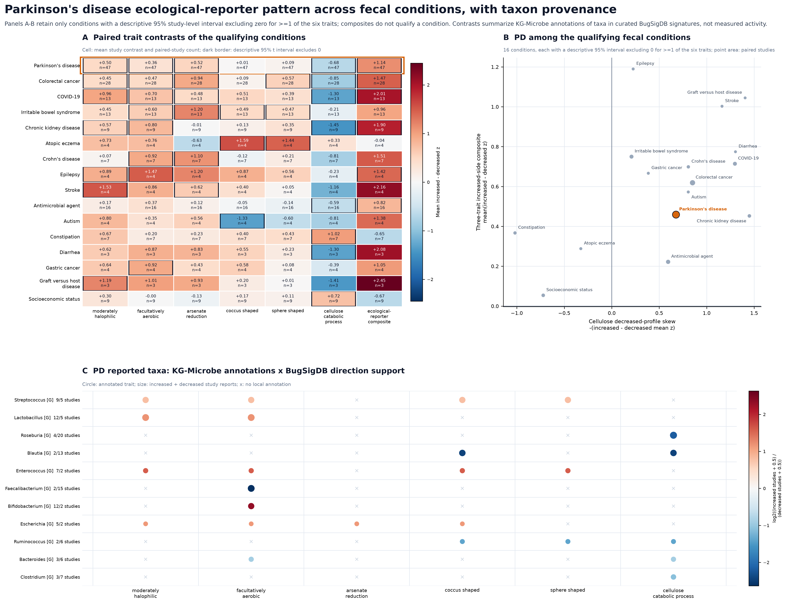
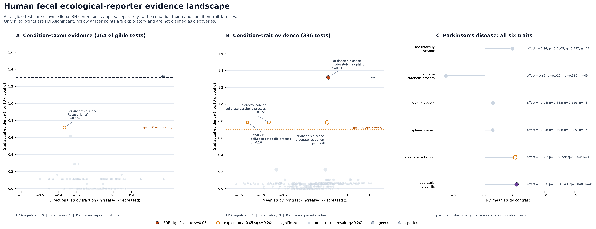

# PD Ecological-Reporter Specificity and Provenance

## Terminology

An **ecological reporter** is a microbial community or trait pattern that reflects the
environment in which the microbes live. Here, the phrase means that gut taxa and their
KG-Microbe trait annotations may report changes associated with host state, intestinal
transit, diet, medication, inflammation, oxygen/redox conditions, or other ecological
pressures. It does not mean that the organisms are literal sensors, and it does not establish
which host change produced the pattern.

For each trait and study, the analysis first calculates:

```text
trait contrast = mean trait z in increased profiles - mean trait z in decreased profiles
```

The exploratory **ecological-reporter composite** is:

```text
mean(
  moderately halophilic contrast,
  facultatively aerobic contrast,
  arsenate reduction contrast
) - cellulose catabolic process contrast
```

A high positive value therefore requires both parts of the proposed pattern: the three
positive-side traits are stronger in increased profiles, while cellulose catabolic process is
stronger in decreased profiles. The composite is a descriptive, study-level summary. It is not
a validated diagnostic score or a patient-level measurement.

## Combined Figure



### Panel A: disease fingerprints

Rows are selected fecal condition labels and columns are the six shared traits plus the
ecological-reporter composite. Each cell is the mean of paired within-study contrasts, so studies
are weighted equally rather than allowing studies with more profiles to dominate. Red means the
trait is stronger in increased profiles; blue means it is stronger in decreased profiles. `n=` is
the number of studies containing both directions. A dark border means the descriptive 95% t
interval excludes zero. The orange outline identifies the PD row.

### Panel B: specificity among conditions

Each point is one of the 56 fecal condition labels with at least three paired studies. Gray points
provide the full background; named colored points are PD and selected physiological or disease
comparators. Point size increases with paired-study count.

The x-axis is the cellulose contrast with its sign reversed. Moving right means cellulose
catabolic process is relatively stronger in decreased profiles.

The y-axis, **three-trait increased-side composite**, means:

```text
mean(
  moderately halophilic increased-minus-decreased z,
  facultatively aerobic increased-minus-decreased z,
  arsenate reduction increased-minus-decreased z
)
```

Moving upward means those three traits are, on average, stronger in increased profiles. The
upper-right quadrant therefore matches both components of the proposed ecological-reporter
pattern. PD being in that quadrant shows pattern agreement, not PD specificity: several other
conditions occupy the same region.

### Panel C: PD taxon and trait provenance

Rows are exact genus or species labels reported in PD fecal BugSigDB signatures; columns are the
six shared traits. A circle means the local KG-Microbe matrix annotates that taxon with the trait.
Circle size represents distinct-study support. Circle color shows the log2 ratio of increased to
decreased BugSigDB study support, with red favoring increased and blue favoring decreased. An `x`
means no local annotation for that taxon-trait cell. Taxonomic ranks are kept separate and are not
summed.

For PD, the study-weighted cellulose increased-minus-decreased contrast is `-0.651` across `45` paired studies. The exploratory reporter composite is `+1.150`. The composite equals the mean contrasts for moderately halophilic, facultatively aerobic, and arsenate reduction minus the cellulose contrast; it is not a validated diagnostic score.

[Condition/trait audit table](pd_ecological_reporter_combined_condition_trait_summary.tsv) | [Study contrasts](pd_ecological_reporter_combined_study_contrasts.tsv) | [Taxon-panel cells](pd_ecological_reporter_combined_taxon_panel.tsv) | [Vector figure](pd_ecological_reporter_combined.svg)

## Condition-Taxon-Trait Evidence Landscape



The regenerated figure separates inference from annotation provenance. It screened every human
fecal condition with at least three studies containing both increased and decreased BugSigDB
signatures. Exact genus and species IDs were kept separate, required at least three reporting
studies, and were tested with an exact McNemar/binomial test on discordant paired studies. The
complete eligible condition-taxon family was corrected globally with Benjamini-Hochberg.

The evidence landscape displays all eligible tests without weakening the significance standard:

- Filled points pass global `q <= 0.05` and are called FDR-significant.
- Hollow amber points have `0.05 < q <= 0.20`. They are exploratory follow-up hypotheses, not
  significant discoveries.
- Gray points have `q > 0.20` and provide the full tested background.

Panel A shows condition-taxon tests. The x-axis is the fraction of paired studies favoring
increased rather than decreased reporting, while the y-axis is `-log10(global q)`. Circles are
genera, triangles are species, and point area represents the number of reporting studies. No
condition-taxon result passes `q <= 0.05`.

Panel B shows all condition-trait tests. Its x-axis is the mean study-level
increased-minus-decreased trait contrast, its y-axis is `-log10(global q)`, and point area is the
number of paired studies. Only Parkinson's disease to moderately halophilic passes
(`mean contrast = +0.530`, `q = 0.048`, `n = 45`).

The exploratory tier contains one taxon result—Parkinson's disease to *Roseburia* (`q = 0.192`)—
and three trait results: Parkinson's disease to arsenate reduction, COVID-19 to cellulose
catabolic process, and colorectal cancer to cellulose catabolic process (each `q = 0.164`). These
are shown to support follow-up planning, not as significant findings.

Panel C shows all six Parkinson's disease trait effects with their raw `p`, globally adjusted `q`,
and study count. This provides PD-specific context while retaining the correction across the full
condition-trait family.

The node and edge audit tables remain significant-only. If taxon results pass in a future data
release, KG-Microbe taxon-to-trait annotations will remain explicitly noninferential because they
do not have p-values and do not measure microbial activity.

[Statistical methods and result counts](pd_condition_taxon_trait_network_methods.md) |
[All condition-taxon tests](pd_condition_taxon_trait_network_condition_taxon_tests.tsv) |
[All condition-trait tests](pd_condition_taxon_trait_network_condition_trait_tests.tsv) |
[Condition eligibility](pd_condition_taxon_trait_network_condition_eligibility.tsv) |
[Study trait contrasts](pd_condition_taxon_trait_network_study_trait_contrasts.tsv) |
[Network nodes](pd_condition_taxon_trait_network_nodes.tsv) |
[Network edges](pd_condition_taxon_trait_network_edges.tsv) |
[Taxon selection](pd_condition_taxon_trait_network_taxon_selection.tsv) |
[Vector figure](pd_condition_taxon_trait_network.svg)

## Interpretation Boundary

These are ecological annotations of taxa found in curated differential-abundance signatures. They
are not measurements of gene expression, metabolite flux, cellulose degradation, or longitudinal
host physiology. The condition comparison is descriptive and is not an external diagnostic
validation. The figures can support a hypothesis that microbial traits act as host-state readouts;
they cannot identify the underlying host signal or establish causality.
