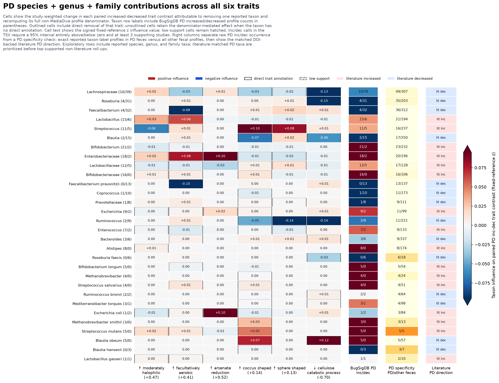

# Exploratory PD Taxa-by-Six-Trait Influence Heatmap

This is the expanded companion to the strict species-only influence heatmap. It includes reported PD fecal taxa at species, genus, and family rank, uses a lower exploratory support threshold of 2 studies, and caps the display at 30 rows so the figure stays readable. Rows are selected by keeping DOI-backed PD literature matches first, then adding the best-supported non-literature rank roll-ups.

The displayed figure contains 30 taxa out of 198 eligible species/genus/family rows, 30 of which match the curated PD taxa reference. It has 6 traits and 180 taxon-trait cells. Cell status counts: {'mixed': 173, 'dec': 6, 'inc': 1}.

Use this view to find candidate taxa and rank-level patterns that the conservative species-only heatmap may miss. Treat it as hypothesis-generating: genus and family rows can mix multiple species, and the relaxed support threshold is meant to reveal leads, not final directional claims.

[Cell statistics](pd_exploratory_taxa_six_traits_influence_heatmap_cells.tsv) | [Taxon row annotations](pd_exploratory_taxa_six_traits_influence_heatmap_taxa.tsv) | [PD specificity](pd_exploratory_taxa_six_traits_influence_heatmap_specificity.tsv) | [Trait summary](pd_exploratory_taxa_six_traits_influence_heatmap_traits.tsv) | [PD taxa reference](pd_exploratory_taxa_six_traits_reference_table.tsv) | [Reference interpretation](pd_exploratory_taxa_six_traits_reference_interpretation.md) | [Manifest](pd_exploratory_taxa_six_traits_influence_heatmap_manifest.json) | [Vector figure](pd_exploratory_taxa_six_traits_influence_heatmap.svg)
