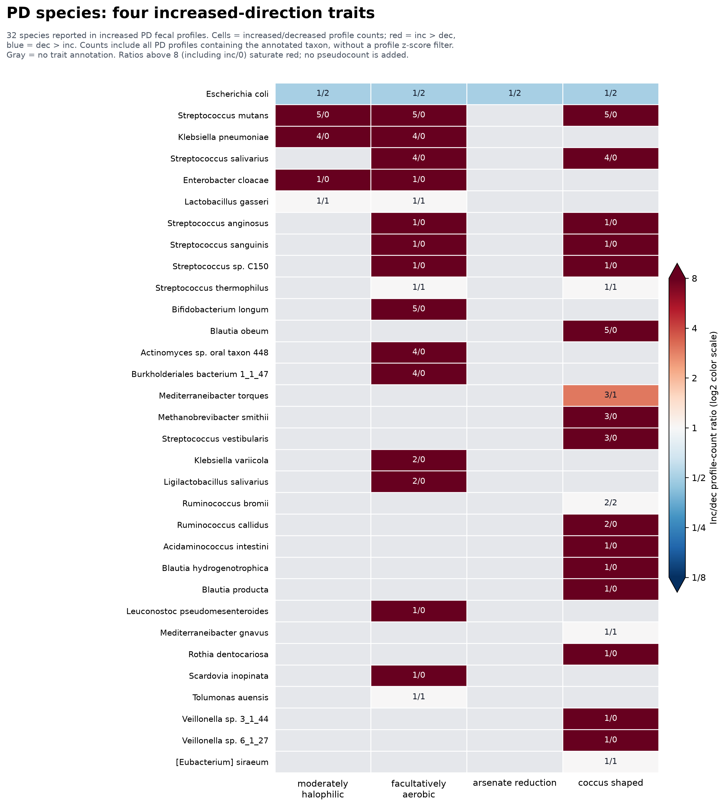

# PD Species-by-Four-Trait Heatmap

Includes all 32 reported species occurring in at least one increased PD fecal profile and annotated for at least one of the four positive-side lollipop traits. Species is the lowest rank available in the carrier data. Genus and higher-rank observations are excluded, not reassigned to species. Labels such as 'sp.' retain the species rank and names supplied by the source.

Cells display inc/dec counts of distinct profiles containing that annotated taxon, out of the source cohort of 130 increased and 123 decreased PD fecal profiles. These are raw occurrence counts, not abundance estimates or normalized prevalence ratios. No positive-z or p-value filter is applied. An inc/0 ratio is infinite; its color saturates at the upper scale limit without adding a pseudocount. Gray indicates an absent annotation, not a zero observation count or proven trait absence. Counts repeat across traits carried by the same species because the underlying taxon occurrences are the same.

KG-Microbe annotations may originate at the reported taxon or its descendants. Multiple annotated traits need not be experimentally verified in the same strain. The coccus-shaped lollipop effect is nearly neutral (+0.017).

[Exact cell counts and ratios](pd_species_four_increased_traits_inc_dec_heatmap_cells.tsv) | [Vector figure](pd_species_four_increased_traits_inc_dec_heatmap.svg)
