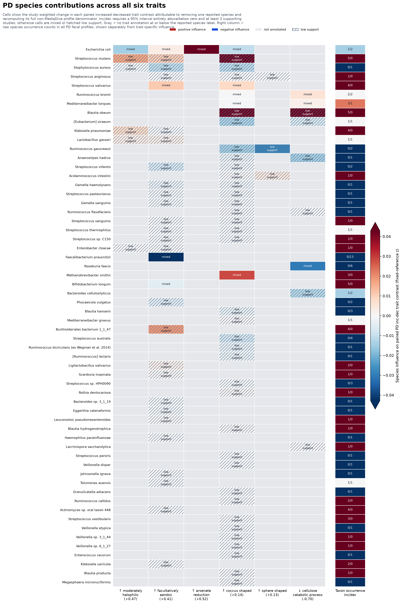

# PD Species-by-Six-Trait Influence Heatmap

Includes 60 reported species - the lowest reliable rank in the PD carrier data - and all six lollipop traits. Each trait cell is now specific to the species-trait combination: the analysis removes the species' complete non-MediaDive annotation vector from profiles where it was reported, recomputes the six log-fraction scores using the unchanged human-corpus reference, forms paired increased-minus-decreased experiment contrasts, averages experiments within study, and weights studies equally.

`inc` and `dec` require at least 3 supporting studies and a 95% Student t interval entirely above or below zero. `mixed` retains supported estimates whose interval crosses zero; hatched `low support` cells do not receive a forced direction. Gray means the trait matrix has no annotation at or below that reported species label. The separate right-hand annotation retains the raw increased/decreased profile occurrence counts.

This is a reported-species influence diagnostic, not a causal attribution or strain-level measurement. Removing a reported species changes both trait numerators and the nonlinear full denominator. Parent/child propagation and unresolved source assertions remain the limitations documented in #190; contrast orientation and trait semantics remain bounded by #188 and #189.

[Cell statistics](pd_species_six_traits_influence_heatmap_cells.tsv) | [Taxon row annotations](pd_species_six_traits_influence_heatmap_taxa.tsv) | [Trait summary](pd_species_six_traits_influence_heatmap_traits.tsv) | [Manifest](pd_species_six_traits_influence_heatmap_manifest.json) | [Vector figure](pd_species_six_traits_influence_heatmap.svg)
