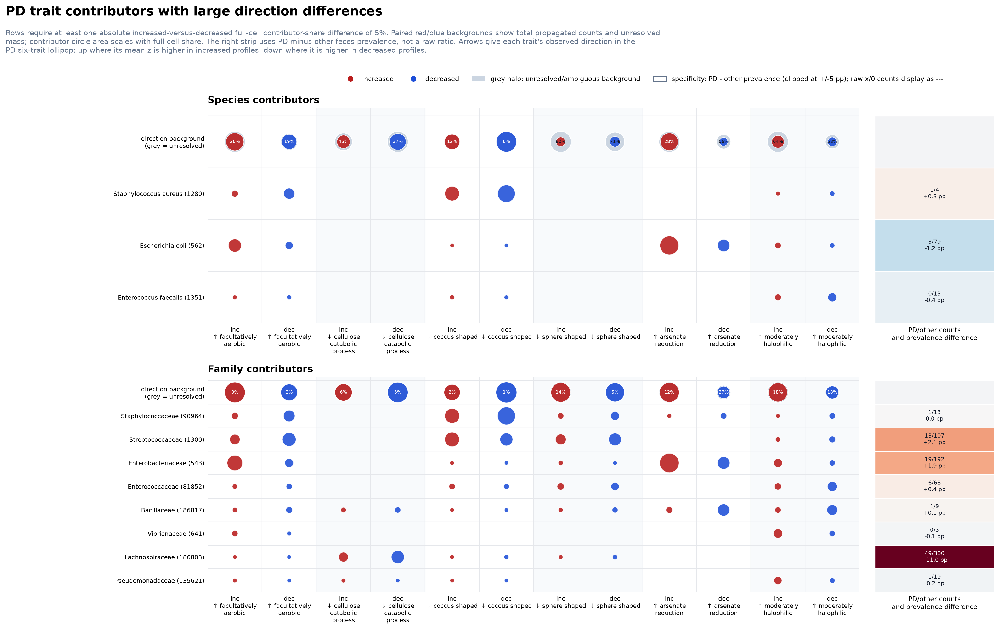
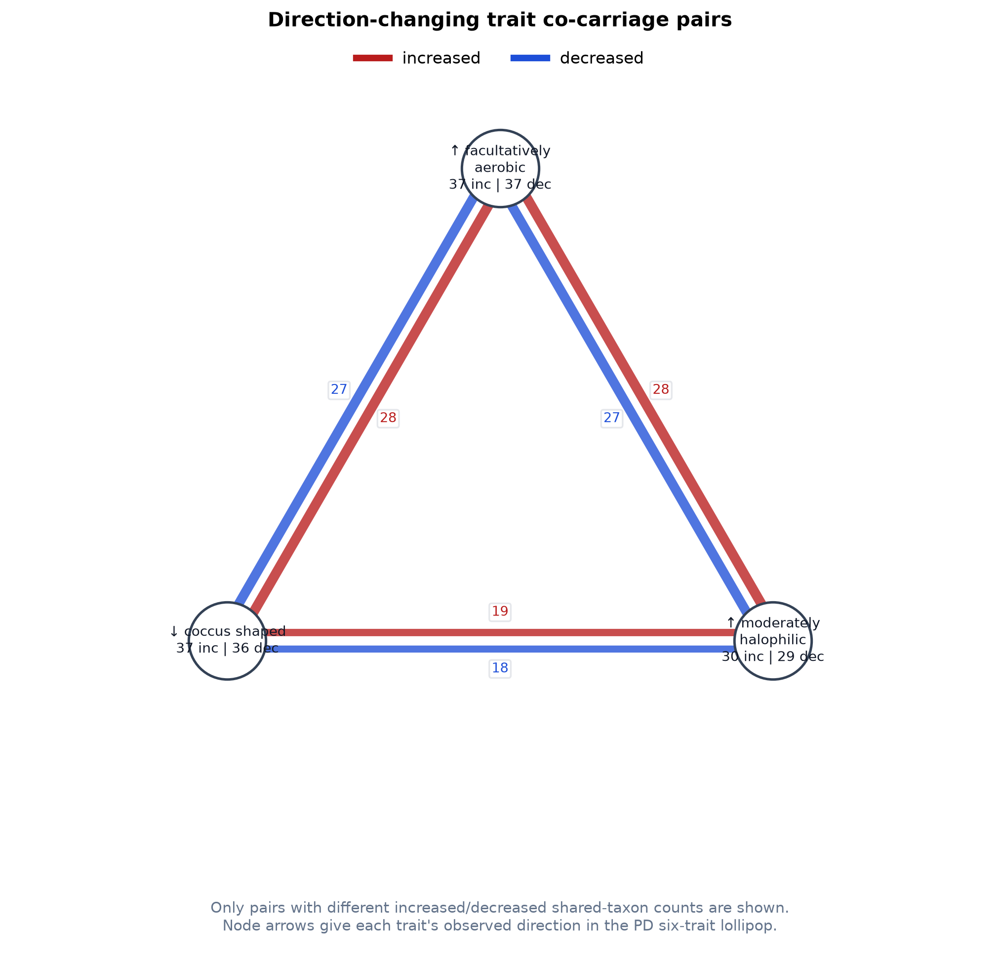

# PD Trait Contributor Dot Heatmap

Counts come from the Table 1 contribution ledger (`mtp.contribution_inputs`, `mtp.taxon_contributions`, #190) on the pinned KG-Microbe release. They cover the 194 PD fecal profiles that the ledger retains (97 increased and 97 decreased, from 43 studies): human profiles in experiments with both directions, out of 242 PD fecal profiles. Every trait-bearing KG taxon at or below a reported taxon adds one count, once per reported taxon, exactly as the taxa-trait matrix and the profile trait sums count it. Each such taxon is attributed to its species and its family when the pinned taxonomy gives exactly one; otherwise it is unresolved (no ancestor at that rank) or ambiguous (several).

Each trait carries its observed direction in the PD six-trait lollipop, the sign of `increased_minus_decreased_mean_z` in `pd_six_trait_direction_summary.tsv`: the `trait_direction` column in the cell, coverage and co-carriage tables, and an up or down arrow in the figure labels.

The background row replaces the separate unresolved-share bars. Within each trait, paired red/blue circle area compares the increased/decreased propagated count; the grey outer area is the portion unresolved or ambiguous at the displayed rank. Contributor circle area uses the full cell denominator, so unresolved mass already reduces the colored contributor share rather than being discarded.

The heatmap retains `11` of `53` candidate taxa. A row must have at least one absolute increased-versus-decreased full-cell contributor share difference of `5%`. This removes rows containing only small directional changes.

The direction-difference table retains 149 of 318 taxon-trait pairs whose full-cell contributor share changes between directions. Equal pairs, including pairs absent in both directions, are omitted.

The right strip colors taxa by the profile-pool-normalized prevalence difference (`PD prevalence - other-feces prevalence`) in percentage points. This finite difference is used instead of a count ratio, so a small or zero other-feces count cannot create an infinite ratio. Raw count displays with a zero denominator, such as `1/0`, are rendered as `---`. The metric remains descriptive and does not account for study clustering.

## Direction-changing co-carriage pairs

Only 3 of 15 trait pairs have different selected-taxon co-carriage counts between directions and are displayed:

| trait pair | increased | decreased | inc - dec | increased-only taxa | decreased-only taxa |
| --- | ---: | ---: | ---: | --- | --- |
| coccus shaped + moderately halophilic | 19 | 18 | +1 | Bifidobacteriaceae (31953) | none |
| facultatively aerobic + coccus shaped | 28 | 27 | +1 | Bifidobacteriaceae (31953) | none |
| facultatively aerobic + moderately halophilic | 28 | 27 | +1 | Bifidobacteriaceae (31953) | none |

## Aggregate direction patterns

The contributor counts are not valid independent observations for a significance test. As external context, the existing paired, study-weighted aggregate analysis has 95% intervals excluding zero for these traits:

| trait | lollipop direction | mean increased - decreased z | 95% interval | pattern |
| --- | --- | ---: | ---: | --- |
| moderately halophilic | increased | 0.465 | [0.207, 0.723] | inc |
| arsenate reduction | increased | 0.427 | [0.001, 0.852] | inc |
| cellulose catabolic process | decreased | -0.693 | [-1.186, -0.199] | dec |

These intervals are aggregate directional context, not contributor-level tests, and the table does not add a new multiple-testing correction.

## Largest unresolved or ambiguous shares

| rank | trait | direction | unresolved share |
| --- | --- | --- | ---: |
| species | sphere shaped | inc | 80.3% |
| species | sphere shaped | dec | 70.6% |
| species | arsenate reduction | dec | 65.7% |
| species | moderately halophilic | inc | 64.0% |
| species | moderately halophilic | dec | 58.1% |
| species | cellulose catabolic process | inc | 45.2% |

High unresolved shares limit rank-specific attribution. They do not create extra colored contributor mass because every contributor share is divided by the full trait-direction count.

## PD-versus-other-feces occurrence context

Top profile-pool-normalized reported taxon labels (descriptive):

| rank | taxon | PD/other profiles | PD/other prevalence | prevalence difference |
| --- | --- | ---: | ---: | ---: |
| family | Lachnospiraceae (186803) | 49/300 | 20.25%/9.23% | +11.02 pp |
| family | Oscillospiraceae (216572) | 27/215 | 11.16%/6.61% | +4.54 pp |
| family | Lactobacillaceae (33958) | 17/126 | 7.02%/3.88% | +3.15 pp |
| family | Bifidobacteriaceae (31953) | 15/106 | 6.20%/3.26% | +2.94 pp |
| family | Streptococcaceae (1300) | 13/107 | 5.37%/3.29% | +2.08 pp |

## Counting and selection bias

- Counts are propagated taxon-trait assertions, not independent patients, samples, or original source assertions. Repeated experiments and descendant propagation can increase them.
- The candidate species are the union of the top five resolved species per trait-direction cell (at most 50), and the candidate families are the 25 resolved families with the largest total count. Broadly annotated or frequently reported taxa therefore have more opportunities to enter and remain in the selected set.
- Species and family panels are separate resolution views. Parent and descendant labels must not be added as if they were disjoint contributors.
- Co-carriage means that the selected label contributes to both annotation cells; it does not establish within-sample expression, mechanism, or causal PD specificity.

Audit files:

- `pd_trait_contributors_cells.tsv`: long-form source dot cells.
- `pd_trait_contributors_rank_coverage.tsv`: resolved, unresolved and ambiguous count totals.
- `pd_trait_contributors_manifest.json`: profile scope, KG check, input hashes and selection rules.
- `pd_trait_contributors_direction_differences.tsv`: change-only taxon-trait direction pairs.
- `pd_trait_contributors_heatmap_taxa.tsv`: taxa passing the large-difference row filter.
- `pd_trait_contributors_selected_taxa.tsv`: selected taxa with normalized specificity context.
- `pd_trait_contributors_taxon_specificity.tsv`: PD-vs-other-feces counts and prevalence metrics.
- `pd_trait_contributors_trait_cocarriage_taxa.tsv`: direction-specific taxon-by-trait presence.
- `pd_trait_contributors_trait_cocarriage_all_edges.tsv`: all pairwise direction counts.
- `pd_trait_contributors_trait_cocarriage_edges.tsv`: only pairs that change by direction.
- `pd_trait_contributors_species_family_dot_heatmap.svg`: vector contributor heatmap.
- `pd_trait_contributors_trait_cocarriage_network.svg`: vector change-only network.
