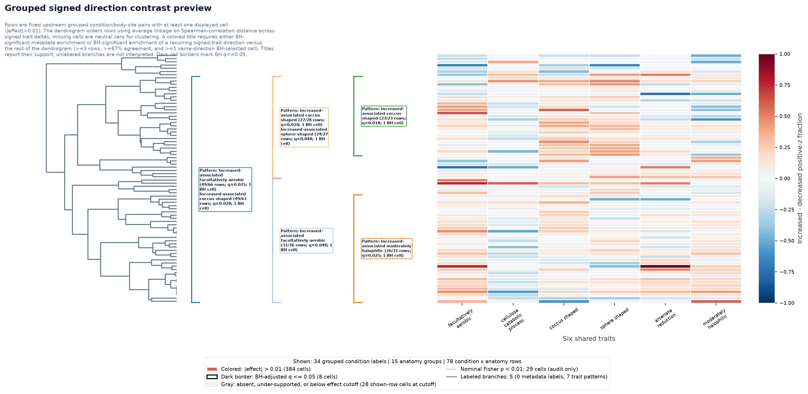

# Six Shared Traits Sankeys

These outputs render the six pooled paired-contrast traits with `q_value <= 0.001` as two combined condition-to-body-site Sankey maps plus readability variants and twelve individual trait-direction Sankey maps.

## Inputs

- Profile counts: `data/derived/study_trait_profiles_wide.tsv`
- Human profile metadata: `trait-visualization/study_trait_profile_study_metadata.tsv`
- Paired trait statistics: `trait-visualization/trait-profile-investigation/trait_profile_paired_contrast_trait_stats.tsv`

## Scoring

For each trait, raw KG-Microbe trait counts were divided by the profile's total trait signal, scaled per 1,000 counts, log1p-transformed, and standardized to z-scores across the human-host profile universe used by the existing study trait profile maps. Each trait is then treated as a one-trait guild.

## Combined Readability Variants

- `combined_direction`: all-edge overlay for one profile direction, with same-color links bundled into one summed trunk per body site.
- `combined_trait_lanes`: option 1; one figure per direction with six stacked trait lanes, preserving all displayed trait-specific links while separating line crossings by trait.
- `combined_shared_high_support`: option 2; one reduced overlay per direction, limited to the top 12 condition/body-site pairs selected from pairs shared by at least 3 traits or with at least 30 positive-z focus profiles.
- `combined_individual_conditions`: one figure per direction with raw individual condition labels on the left and grouped v3 body-site labels on the right. Same-trait records from one condition into one body-site group are summed into a single colored link, then bundled into one body-site trunk per trait color.
- `single_trait_direction`: individual one-trait, one-direction Sankeys.

The combined maps retain the individual trait-direction edge records. Every colored curve in the combined maps is a trait-specific condition/body-site link. The individual maps show one trait and one profile direction per figure. Curve width is the focus-direction positive-z profile count for that trait and shade is the mean positive focus-profile z-score. The overlay maps use the same numeric color range for all six trait-specific monochrome scales. Light grey underlays show the z <= 0 background for the same condition/body-site/trait link. Parallel curves sharing a condition/body-site pair are ordered by edge width from thickest to thinnest. In `combined_direction` and `combined_individual_conditions`, links approaching each body-site node merge into at most six colored trunks, one per trait color scale.

Image node keys spell out the compact labels used in the PNGs: `n=` is positive-z focus-profile support, `s=` is the unique study count for `n`, `bg=` is z <= 0 background-profile support, `links=` is plotted trait-specific link count, and `traits=` is the number of distinct traits represented at a combined-map node.

Node counts are profile-trait memberships across displayed links, not deduplicated profile totals. Use the edge TSVs for exact trait-specific counts, study IDs, raw rolled-up labels, and increased-minus-decreased contrasts.

## Traits

| trait | ID | color | q-value | paired direction | profile count | positive-z profiles |
| --- | --- | --- | ---: | --- | ---: | ---: |
| facultatively aerobic | `METPO:1000608` | `#0072b2` | 2.78e-10 | trait enriched in increased profiles | 5829 | 2971 |
| cellulose catabolic process | `METPO:2000103|GO:0030245` | `#d55e00` | 6.9e-07 | trait enriched in decreased profiles | 5829 | 1847 |
| coccus shaped | `METPO:1000668` | `#009e73` | 1.13e-06 | trait enriched in increased profiles | 5829 | 2689 |
| sphere shaped | `METPO:1000683` | `#cc79a7` | 1.95e-05 | trait enriched in increased profiles | 5829 | 2445 |
| arsenate reduction | `METPO:2000103|pathways:arsenate_reduction` | `#e69f00` | 1.95e-05 | trait enriched in increased profiles | 5829 | 1401 |
| moderately halophilic | `METPO:1000623` | `#6a3d9a` | 3.11e-05 | trait enriched in increased profiles | 5829 | 2648 |

## Outputs

| analysis | type | PNG | displayed trait links | selected pairs | all edge rows |
| --- | --- | --- | ---: | ---: | ---: |
| six_shared_traits_increased | combined_direction | `trait-visualization/trait-profile-investigation/six-shared-traits/six_shared_traits_increased_profile_sankey.png` | 188 |  | 682 |
| six_shared_traits_decreased | combined_direction | `trait-visualization/trait-profile-investigation/six-shared-traits/six_shared_traits_decreased_profile_sankey.png` | 185 |  | 652 |
| six_shared_traits_increased_trait_lanes | combined_trait_lanes | `trait-visualization/trait-profile-investigation/six-shared-traits/six_shared_traits_increased_trait_lanes_profile_sankey.png` | 188 |  | 682 |
| six_shared_traits_decreased_trait_lanes | combined_trait_lanes | `trait-visualization/trait-profile-investigation/six-shared-traits/six_shared_traits_decreased_trait_lanes_profile_sankey.png` | 185 |  | 652 |
| six_shared_traits_increased_shared_high_support | combined_shared_high_support | `trait-visualization/trait-profile-investigation/six-shared-traits/six_shared_traits_increased_shared_high_support_profile_sankey.png` | 72 | 12 | 72 |
| six_shared_traits_decreased_shared_high_support | combined_shared_high_support | `trait-visualization/trait-profile-investigation/six-shared-traits/six_shared_traits_decreased_shared_high_support_profile_sankey.png` | 72 | 12 | 72 |
| six_shared_traits_increased_individual_conditions | combined_individual_conditions | `trait-visualization/trait-profile-investigation/six-shared-traits/six_shared_traits_increased_individual_conditions_profile_sankey.png` | 117 |  | 2001 |
| six_shared_traits_decreased_individual_conditions | combined_individual_conditions | `trait-visualization/trait-profile-investigation/six-shared-traits/six_shared_traits_decreased_individual_conditions_profile_sankey.png` | 105 |  | 1893 |
| facultatively_aerobic_increased | single_trait_direction | `trait-visualization/trait-profile-investigation/six-shared-traits/facultatively_aerobic_increased_profile_sankey.png` | 32 |  | 126 |
| facultatively_aerobic_decreased | single_trait_direction | `trait-visualization/trait-profile-investigation/six-shared-traits/facultatively_aerobic_decreased_profile_sankey.png` | 32 |  | 123 |
| cellulose_catabolic_process_increased | single_trait_direction | `trait-visualization/trait-profile-investigation/six-shared-traits/cellulose_catabolic_process_increased_profile_sankey.png` | 29 |  | 89 |
| cellulose_catabolic_process_decreased | single_trait_direction | `trait-visualization/trait-profile-investigation/six-shared-traits/cellulose_catabolic_process_decreased_profile_sankey.png` | 26 |  | 87 |
| coccus_shaped_increased | single_trait_direction | `trait-visualization/trait-profile-investigation/six-shared-traits/coccus_shaped_increased_profile_sankey.png` | 32 |  | 123 |
| coccus_shaped_decreased | single_trait_direction | `trait-visualization/trait-profile-investigation/six-shared-traits/coccus_shaped_decreased_profile_sankey.png` | 32 |  | 118 |
| sphere_shaped_increased | single_trait_direction | `trait-visualization/trait-profile-investigation/six-shared-traits/sphere_shaped_increased_profile_sankey.png` | 32 |  | 121 |
| sphere_shaped_decreased | single_trait_direction | `trait-visualization/trait-profile-investigation/six-shared-traits/sphere_shaped_decreased_profile_sankey.png` | 32 |  | 113 |
| arsenate_reduction_increased | single_trait_direction | `trait-visualization/trait-profile-investigation/six-shared-traits/arsenate_reduction_increased_profile_sankey.png` | 31 |  | 99 |
| arsenate_reduction_decreased | single_trait_direction | `trait-visualization/trait-profile-investigation/six-shared-traits/arsenate_reduction_decreased_profile_sankey.png` | 31 |  | 90 |
| moderately_halophilic_increased | single_trait_direction | `trait-visualization/trait-profile-investigation/six-shared-traits/moderately_halophilic_increased_profile_sankey.png` | 32 |  | 124 |
| moderately_halophilic_decreased | single_trait_direction | `trait-visualization/trait-profile-investigation/six-shared-traits/moderately_halophilic_decreased_profile_sankey.png` | 32 |  | 121 |

## Cytoscape Graph Explorer

- Interactive graph explorer: `six_shared_traits_profile_graphs.html`
- Inline graph data audit copy: `six_shared_traits_profile_graph_data.json`
- Graph manifest: `six_shared_trait_graph_manifest.tsv`

The graph explorer uses Cytoscape.js from jsDelivr and includes four views: increased/decreased grouped conditions and increased/decreased individual conditions. Each source condition link connects to a trait/body-site bundle node adjacent to its body-site node, then each bundle connects directly to that body-site node. Source and body-site connector widths use separate scales.

| view | condition nodes | body-site nodes | trait/body-site bundles | source edges | body-site connectors |
| --- | ---: | ---: | ---: | ---: | ---: |
| Increased, grouped conditions | 19 | 15 | 73 | 188 | 73 |
| Decreased, grouped conditions | 17 | 14 | 71 | 185 | 71 |
| Increased, individual conditions | 23 | 12 | 50 | 117 | 50 |
| Decreased, individual conditions | 23 | 11 | 52 | 105 | 52 |

## Static Cytoscape-Inspired PNG Graphs

- Manifest: `six_shared_trait_static_graph_manifest.tsv`

These PNGs are graph versions of the six shared trait Sankey views. They use six central trait hubs rather than condition-to-body-site flow bands. Trait-to-body-site links accumulate into small colored bundle nodes adjacent to each body site, then connect directly to the corresponding body-site node. Condition-to-trait and trait-to-body-site widths use separate scales.

| view | PNG | condition nodes | trait hubs | body-site nodes | trait/body-site bundles | condition-trait edges | trait-body links | body-site connectors |
| --- | --- | ---: | ---: | ---: | ---: | ---: | ---: | ---: |
| Increased, grouped conditions | `trait-visualization/trait-profile-investigation/six-shared-traits/six_shared_traits_increased_grouped_cytoscape_hub_graph.png` | 19 | 6 | 15 | 73 | 72 | 73 | 73 |
| Decreased, grouped conditions | `trait-visualization/trait-profile-investigation/six-shared-traits/six_shared_traits_decreased_grouped_cytoscape_hub_graph.png` | 17 | 6 | 14 | 71 | 72 | 71 | 71 |
| Increased, individual conditions | `trait-visualization/trait-profile-investigation/six-shared-traits/six_shared_traits_increased_individual_conditions_cytoscape_hub_graph.png` | 23 | 6 | 12 | 50 | 72 | 50 | 50 |
| Decreased, individual conditions | `trait-visualization/trait-profile-investigation/six-shared-traits/six_shared_traits_decreased_individual_conditions_cytoscape_hub_graph.png` | 23 | 6 | 11 | 52 | 72 | 52 | 52 |

## Condition-Body-Site Cytoscape Heatmaps

- Manifest: `six_shared_trait_cytoscape_heatmap_manifest.tsv`
- Pattern matrix table: `six_shared_trait_condition_body_site_trait_pattern_matrix.tsv`
- Signed contrast table: `six_shared_trait_condition_body_site_direction_contrasts.tsv`
- Grouped signed-direction cluster rows: `six_shared_traits_grouped_signed_direction_cluster_rows.tsv`
- Grouped signed-direction cluster summary: `six_shared_traits_grouped_signed_direction_cluster_summary.tsv`
- Grouped dendrogram branch-label tests: `six_shared_traits_grouped_signed_direction_branch_label_tests.tsv`
- Grouped dendrogram trait-pattern tests: `six_shared_traits_grouped_signed_direction_branch_pattern_tests.tsv`
- BH-selected cell table: `six_shared_trait_condition_body_site_bh_selected_cells.tsv`

Trait-pattern heatmaps use the six-shared-trait display-edge TSVs that feed the Cytoscape graph views. Signed contrasts use the full increased and decreased edge TSVs before graph display selection. They preserve condition/body-site/trait records instead of correlating already-collapsed condition and body-site nodes.

Signed contrasts display supported, testable effects whose absolute magnitude is greater than 0.01, including nonsignificant results. Gray cells are unavailable, under-supported, or at or below the effect cutoff. Trait-pattern heatmaps continue to mask cells that fail the nominal p-value threshold.

### How Conditions and Cluster Labels Are Chosen

The signed heatmaps do not choose a top-N disease list. They read the full increased and decreased Sankey edge tables before graph display selection and include every condition/body-site row with at least one supported, finite cell above the absolute-effect cutoff. The grouped view uses the fixed upstream v3 clinical rollup; the individual view retains the original curated condition label. Both use the upstream grouped v3 anatomy label. These condition and anatomy names are not inferred from the dendrogram.

Grouped conditions are assigned by the ordered, case-insensitive substring rules in `v3_fully_grouped_condition_display_label`: the first matching rule wins and unmatched labels become `Other specific clinical labels`. The per-trait `*_profile_sankey_condition_rollups.tsv` files audit each raw label, displayed label, rule, profile count, and study count. Every internal dendrogram branch is tested for one-sided enrichment of each eligible anatomy and grouped-condition label versus all rows outside that branch. BH adjustment covers the complete tested branch-by-label family. A branch is colored and named only when q<=0.05, it has at least 3 rows and 2 matching rows, and the label describes at least two-thirds of the branch. Every qualifying nested branch is drawn in a separate annotation track. Each visible label reports its matching-row fraction and adjusted q-value; unlabeled branches are not interpreted.
A branch without significant anatomy/condition enrichment may instead receive a descriptive trait-pattern title. Each branch/trait/direction is tested for one-sided enrichment against displayed rows outside the branch, with BH adjustment across the complete branch-pattern family. A displayed pattern requires q<=0.05, at least three same-direction displayed cells, at least two-thirds directional agreement, and at least one same-direction cell already selected at heatmap-wide BH q<=0.05. Pattern titles report the matching-row fraction, branch-pattern q-value, and BH-cell count. The pattern-test TSV records every test and selection flag.

- `trait_pattern`: Approach 2. Rows are condition/body-site pairs and columns are the six traits. Cell color is Fisher evidence, `-log10(p)`, rendered with a yellow-to-blue sequential palette so darker cells have smaller p-values. Cells require Fisher p<0.01, n>=3, and s>=2 for exploratory display.
- `signed_direction_contrast`: Approach 4. Rows are condition/body-site pairs and columns are traits. Cell color and numbers are `increased_fraction - decreased_fraction` on a fixed -1 to +1 scale. Red favors increased profiles and blue favors decreased profiles. A dark border marks BH-adjusted q<=0.05; the nominal Fisher p<0.01 flag is reported separately. Unbordered cells are descriptive effects. Cells also require absolute effect >0.01.
- Condition/body-site rows are chosen from the full increased and decreased edge TSVs, not from the graph display subset. A row is retained when at least one trait cell has a finite increased-vs-decreased Fisher test, absolute effect above the cutoff, at least 3 positive-z profiles in either direction, and at least 2 total studies.
- The grouped signed-direction heatmap is a single clustered diagram. Rows use average linkage on Spearman-correlation distance across the six signed trait deltas; missing or unsupported cells are neutral zero for clustering. The left dendrogram orders condition/anatomy rows. Only branches passing the multiplicity-adjusted enrichment, minimum-size, and minimum-purity rules receive an anatomy/condition title. Other branches can receive a descriptive trait-pattern title only under branch-pattern BH significance, BH-cell support, recurrence, and directional-purity rules. All qualifying nested labels are separated into tracks, and the two audit TSVs preserve every rejected and accepted metadata or trait-pattern candidate.
- Individual-condition signed-direction heatmaps still receive readable pages containing at most 24 rows each. `six_shared_trait_signed_direction_heatmap_pages.tsv` records only those individual-condition page paths and counts.
- BH q-values are computed within each heatmap view. `selected_after_bh=True` marks supported cells with q<=0.05; visible selected cells receive the dark border and selected candidates are collected in the BH-selected cell table. `nominal_p_value_selected` is the explicit nominal flag; `significant_in_heatmap` remains a compatibility alias for that nominal flag.
- Issue #256 / PR #257 adds pooled, denominator-harmonized, study-weighted fraction and log-ratio quantities, but no condition-by-anatomy replacement for this heatmap. Those pooled quantities are not mixed into this profile-level positive-z prevalence contrast because the estimands and sampling units differ.

### Grouped Signed-Direction Cluster Preview

| heatmap | type | PNG | displayed cells | nominal p<0.01 cells | BH-selected cells | tested cells | rows | condition labels | anatomy groups | supported dendrogram branches | metadata labels | trait-pattern labels |
| --- | --- | --- | ---: | ---: | ---: | ---: | ---: | ---: | ---: | ---: | ---: | ---: |
| Increased, grouped conditions | trait_pattern | `trait-visualization/trait-profile-investigation/six-shared-traits/six_shared_traits_increased_grouped_condition_body_site_trait_pattern_heatmap.png` | 15 |  | 5 | 188 | 9 |  |  |  |  |  |
| Decreased, grouped conditions | trait_pattern | `trait-visualization/trait-profile-investigation/six-shared-traits/six_shared_traits_decreased_grouped_condition_body_site_trait_pattern_heatmap.png` | 6 |  | 4 | 185 | 6 |  |  |  |  |  |
| Increased, individual conditions | trait_pattern | `trait-visualization/trait-profile-investigation/six-shared-traits/six_shared_traits_increased_individual_conditions_condition_body_site_trait_pattern_heatmap.png` | 4 |  | 2 | 117 | 2 |  |  |  |  |  |
| Decreased, individual conditions | trait_pattern | `trait-visualization/trait-profile-investigation/six-shared-traits/six_shared_traits_decreased_individual_conditions_condition_body_site_trait_pattern_heatmap.png` | 5 |  | 4 | 105 | 5 |  |  |  |  |  |
| Grouped conditions: signed direction contrast | signed_direction_contrast | `trait-visualization/trait-profile-investigation/six-shared-traits/six_shared_traits_grouped_condition_body_site_signed_direction_contrast_heatmap.png` | 384 | 29 | 8 | 747 | 78 | 34 | 15 | 5 | 0 | 7 |
| Individual conditions: signed direction contrast | signed_direction_contrast | `trait-visualization/trait-profile-investigation/six-shared-traits/six_shared_traits_individual_conditions_condition_body_site_signed_direction_contrast_heatmap.png` | 567 | 21 | 4 | 2379 | 123 | 105 | 12 | 0 | 0 | 0 |

### Signed Direction Pages

- [Individual conditions, page 1](six_shared_traits_individual_conditions_condition_body_site_signed_direction_contrast_heatmap_page_01.png) (24 rows; 23 condition labels; 2 anatomy groups; 139 displayed cells; 4 BH-bordered cells)
- [Individual conditions, page 2](six_shared_traits_individual_conditions_condition_body_site_signed_direction_contrast_heatmap_page_02.png) (24 rows; 24 condition labels; 1 anatomy groups; 137 displayed cells; 0 BH-bordered cells)
- [Individual conditions, page 3](six_shared_traits_individual_conditions_condition_body_site_signed_direction_contrast_heatmap_page_03.png) (24 rows; 24 condition labels; 1 anatomy groups; 100 displayed cells; 0 BH-bordered cells)
- [Individual conditions, page 4](six_shared_traits_individual_conditions_condition_body_site_signed_direction_contrast_heatmap_page_04.png) (24 rows; 21 condition labels; 6 anatomy groups; 96 displayed cells; 0 BH-bordered cells)
- [Individual conditions, page 5](six_shared_traits_individual_conditions_condition_body_site_signed_direction_contrast_heatmap_page_05.png) (24 rows; 21 condition labels; 6 anatomy groups; 89 displayed cells; 0 BH-bordered cells)
- [Individual conditions, page 6](six_shared_traits_individual_conditions_condition_body_site_signed_direction_contrast_heatmap_page_06.png) (3 rows; 3 condition labels; 1 anatomy groups; 6 displayed cells; 0 BH-bordered cells)
