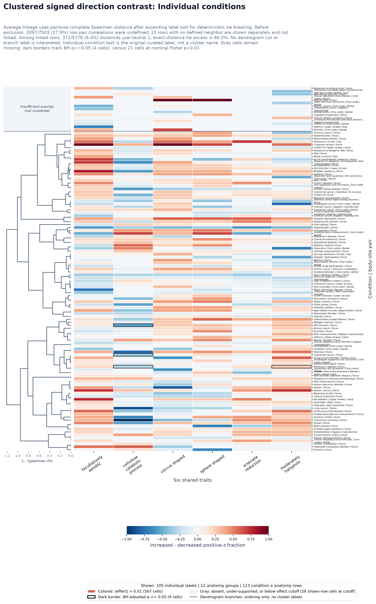

# Six Shared Traits Sankeys

These outputs render the six pooled paired-contrast traits with `q_value <= 0.001` as two combined condition-to-body-site Sankey maps plus readability variants and twelve individual trait-direction Sankey maps.

## Inputs

- Profile counts: `data/derived/study_trait_profiles_wide.tsv`
- Human profile metadata: `trait-visualization/study_trait_profile_study_metadata.tsv`
- Paired trait statistics: `trait-visualization/trait-profile-investigation/trait_profile_paired_contrast_trait_stats.tsv`

## Scoring

For each trait, raw KG-Microbe trait counts were divided by the profile's total trait signal, scaled per 1,000 counts, log1p-transformed, and standardized to z-scores across the human-host profile universe used by the existing study trait profile maps. Each trait is then treated as a one-trait guild.

## Combined Readability Variants

- `combined_direction`: all-edge overlay for one profile direction, with same-color links bundled into one summed trunk per body site.
- `combined_trait_lanes`: option 1; one figure per direction with six stacked trait lanes, preserving all displayed trait-specific links while separating line crossings by trait.
- `combined_shared_high_support`: option 2; one reduced overlay per direction, limited to the top 12 condition/body-site pairs selected from pairs shared by at least 3 traits or with at least 30 positive-z focus profiles.
- `combined_individual_conditions`: one figure per direction with raw individual condition labels on the left and grouped v3 body-site labels on the right. Same-trait records from one condition into one body-site group are summed into a single colored link, then bundled into one body-site trunk per trait color.
- `single_trait_direction`: individual one-trait, one-direction Sankeys.

The combined maps retain the individual trait-direction edge records. Every colored curve in the combined maps is a trait-specific condition/body-site link. The individual maps show one trait and one profile direction per figure. Curve width is the focus-direction positive-z profile count for that trait and shade is the mean positive focus-profile z-score. The overlay maps use the same numeric color range for all six trait-specific monochrome scales. Light grey underlays show the z <= 0 background for the same condition/body-site/trait link. Parallel curves sharing a condition/body-site pair are ordered by edge width from thickest to thinnest. In `combined_direction` and `combined_individual_conditions`, links approaching each body-site node merge into at most six colored trunks, one per trait color scale.

Image node keys spell out the compact labels used in the PNGs: `n=` is positive-z focus-profile support, `s=` is the unique study count for `n`, `bg=` is z <= 0 background-profile support, `links=` is plotted trait-specific link count, and `traits=` is the number of distinct traits represented at a combined-map node.

Node counts are profile-trait memberships across displayed links, not deduplicated profile totals. Use the edge TSVs for exact trait-specific counts, study IDs, raw rolled-up labels, and increased-minus-decreased contrasts.

## Traits

| trait | ID | color | q-value | paired direction | profile count | positive-z profiles |
| --- | --- | --- | ---: | --- | ---: | ---: |
| facultatively aerobic | `METPO:1000608` | `#0072b2` | 2.78e-10 | trait enriched in increased profiles | 5829 | 2971 |
| cellulose catabolic process | `METPO:2000103|GO:0030245` | `#d55e00` | 6.9e-07 | trait enriched in decreased profiles | 5829 | 1847 |
| coccus shaped | `METPO:1000668` | `#009e73` | 1.13e-06 | trait enriched in increased profiles | 5829 | 2689 |
| sphere shaped | `METPO:1000683` | `#cc79a7` | 1.95e-05 | trait enriched in increased profiles | 5829 | 2445 |
| arsenate reduction | `METPO:2000103|pathways:arsenate_reduction` | `#e69f00` | 1.95e-05 | trait enriched in increased profiles | 5829 | 1401 |
| moderately halophilic | `METPO:1000623` | `#6a3d9a` | 3.11e-05 | trait enriched in increased profiles | 5829 | 2648 |

## Outputs

| analysis | type | PNG | displayed trait links | selected pairs | all edge rows |
| --- | --- | --- | ---: | ---: | ---: |
| six_shared_traits_increased | combined_direction | `trait-visualization/trait-profile-investigation/six-shared-traits/six_shared_traits_increased_profile_sankey.png` | 188 |  | 682 |
| six_shared_traits_decreased | combined_direction | `trait-visualization/trait-profile-investigation/six-shared-traits/six_shared_traits_decreased_profile_sankey.png` | 185 |  | 652 |
| six_shared_traits_increased_trait_lanes | combined_trait_lanes | `trait-visualization/trait-profile-investigation/six-shared-traits/six_shared_traits_increased_trait_lanes_profile_sankey.png` | 188 |  | 682 |
| six_shared_traits_decreased_trait_lanes | combined_trait_lanes | `trait-visualization/trait-profile-investigation/six-shared-traits/six_shared_traits_decreased_trait_lanes_profile_sankey.png` | 185 |  | 652 |
| six_shared_traits_increased_shared_high_support | combined_shared_high_support | `trait-visualization/trait-profile-investigation/six-shared-traits/six_shared_traits_increased_shared_high_support_profile_sankey.png` | 72 | 12 | 72 |
| six_shared_traits_decreased_shared_high_support | combined_shared_high_support | `trait-visualization/trait-profile-investigation/six-shared-traits/six_shared_traits_decreased_shared_high_support_profile_sankey.png` | 72 | 12 | 72 |
| six_shared_traits_increased_individual_conditions | combined_individual_conditions | `trait-visualization/trait-profile-investigation/six-shared-traits/six_shared_traits_increased_individual_conditions_profile_sankey.png` | 117 |  | 2001 |
| six_shared_traits_decreased_individual_conditions | combined_individual_conditions | `trait-visualization/trait-profile-investigation/six-shared-traits/six_shared_traits_decreased_individual_conditions_profile_sankey.png` | 105 |  | 1893 |
| facultatively_aerobic_increased | single_trait_direction | `trait-visualization/trait-profile-investigation/six-shared-traits/facultatively_aerobic_increased_profile_sankey.png` | 32 |  | 126 |
| facultatively_aerobic_decreased | single_trait_direction | `trait-visualization/trait-profile-investigation/six-shared-traits/facultatively_aerobic_decreased_profile_sankey.png` | 32 |  | 123 |
| cellulose_catabolic_process_increased | single_trait_direction | `trait-visualization/trait-profile-investigation/six-shared-traits/cellulose_catabolic_process_increased_profile_sankey.png` | 29 |  | 89 |
| cellulose_catabolic_process_decreased | single_trait_direction | `trait-visualization/trait-profile-investigation/six-shared-traits/cellulose_catabolic_process_decreased_profile_sankey.png` | 26 |  | 87 |
| coccus_shaped_increased | single_trait_direction | `trait-visualization/trait-profile-investigation/six-shared-traits/coccus_shaped_increased_profile_sankey.png` | 32 |  | 123 |
| coccus_shaped_decreased | single_trait_direction | `trait-visualization/trait-profile-investigation/six-shared-traits/coccus_shaped_decreased_profile_sankey.png` | 32 |  | 118 |
| sphere_shaped_increased | single_trait_direction | `trait-visualization/trait-profile-investigation/six-shared-traits/sphere_shaped_increased_profile_sankey.png` | 32 |  | 121 |
| sphere_shaped_decreased | single_trait_direction | `trait-visualization/trait-profile-investigation/six-shared-traits/sphere_shaped_decreased_profile_sankey.png` | 32 |  | 113 |
| arsenate_reduction_increased | single_trait_direction | `trait-visualization/trait-profile-investigation/six-shared-traits/arsenate_reduction_increased_profile_sankey.png` | 31 |  | 99 |
| arsenate_reduction_decreased | single_trait_direction | `trait-visualization/trait-profile-investigation/six-shared-traits/arsenate_reduction_decreased_profile_sankey.png` | 31 |  | 90 |
| moderately_halophilic_increased | single_trait_direction | `trait-visualization/trait-profile-investigation/six-shared-traits/moderately_halophilic_increased_profile_sankey.png` | 32 |  | 124 |
| moderately_halophilic_decreased | single_trait_direction | `trait-visualization/trait-profile-investigation/six-shared-traits/moderately_halophilic_decreased_profile_sankey.png` | 32 |  | 121 |

## Cytoscape Graph Explorer

- Interactive graph explorer: `six_shared_traits_profile_graphs.html`
- Inline graph data audit copy: `six_shared_traits_profile_graph_data.json`
- Graph manifest: `six_shared_trait_graph_manifest.tsv`

The graph explorer uses Cytoscape.js from jsDelivr and includes four views: increased/decreased grouped conditions and increased/decreased individual conditions. Each source condition link connects to a trait/body-site bundle node adjacent to its body-site node, then each bundle connects directly to that body-site node. Source and body-site connector widths use separate scales.

| view | condition nodes | body-site nodes | trait/body-site bundles | source edges | body-site connectors |
| --- | ---: | ---: | ---: | ---: | ---: |
| Increased, grouped conditions | 19 | 15 | 73 | 188 | 73 |
| Decreased, grouped conditions | 17 | 14 | 71 | 185 | 71 |
| Increased, individual conditions | 23 | 12 | 50 | 117 | 50 |
| Decreased, individual conditions | 23 | 11 | 52 | 105 | 52 |

## Static Cytoscape-Inspired PNG Graphs

- Manifest: `six_shared_trait_static_graph_manifest.tsv`

These PNGs are graph versions of the six shared trait Sankey views. They use six central trait hubs rather than condition-to-body-site flow bands. Trait-to-body-site links accumulate into small colored bundle nodes adjacent to each body site, then connect directly to the corresponding body-site node. Condition-to-trait and trait-to-body-site widths use separate scales.

| view | PNG | condition nodes | trait hubs | body-site nodes | trait/body-site bundles | condition-trait edges | trait-body links | body-site connectors |
| --- | --- | ---: | ---: | ---: | ---: | ---: | ---: | ---: |
| Increased, grouped conditions | `trait-visualization/trait-profile-investigation/six-shared-traits/six_shared_traits_increased_grouped_cytoscape_hub_graph.png` | 19 | 6 | 15 | 73 | 72 | 73 | 73 |
| Decreased, grouped conditions | `trait-visualization/trait-profile-investigation/six-shared-traits/six_shared_traits_decreased_grouped_cytoscape_hub_graph.png` | 17 | 6 | 14 | 71 | 72 | 71 | 71 |
| Increased, individual conditions | `trait-visualization/trait-profile-investigation/six-shared-traits/six_shared_traits_increased_individual_conditions_cytoscape_hub_graph.png` | 23 | 6 | 12 | 50 | 72 | 50 | 50 |
| Decreased, individual conditions | `trait-visualization/trait-profile-investigation/six-shared-traits/six_shared_traits_decreased_individual_conditions_cytoscape_hub_graph.png` | 23 | 6 | 11 | 52 | 72 | 52 | 52 |

## Condition-Body-Site Cytoscape Heatmaps

- Manifest: `six_shared_trait_cytoscape_heatmap_manifest.tsv`
- Pattern matrix table: `six_shared_trait_condition_body_site_trait_pattern_matrix.tsv`
- Signed contrast table: `six_shared_trait_condition_body_site_direction_contrasts.tsv`
- BH-selected cell table: `six_shared_trait_condition_body_site_bh_selected_cells.tsv`
- Cluster-tree nodes: `six_shared_trait_signed_direction_cluster_tree_nodes.tsv`
- Cluster-tree leaves and row order: `six_shared_trait_signed_direction_cluster_tree_leaves.tsv`
- Individual-versus-grouped comparison: `six_shared_trait_signed_direction_cluster_comparison.tsv`
- Grouped dendrogram cluster membership: `six_shared_trait_grouped_signed_direction_cluster_membership.tsv`
- Grouped dendrogram label-enrichment tests: `six_shared_trait_grouped_signed_direction_cluster_enrichment.tsv`

Trait-pattern heatmaps use the six-shared-trait display-edge TSVs that feed the Cytoscape graph views. Signed contrasts use the full increased and decreased edge TSVs before graph display selection. They preserve condition/body-site/trait records instead of correlating already-collapsed condition and body-site nodes.

Signed contrasts display all supported, testable effects, including nonsignificant results. Gray cells are unavailable or under-supported. Trait-pattern heatmaps continue to mask cells that fail the raw p-value threshold.

### How Conditions and Blank Cells Are Chosen

The signed heatmaps do not choose a top-N list of diseases. They read the full increased and decreased Sankey edge tables before graph display selection, discard unknown raw condition labels upstream, and include every condition/body-site row with at least one supported, finite cell. The grouped view applies the v3 clinical condition rollup rules; the individual view keeps the original curated condition label. Both views use the same grouped v3 body-site labels.

In a signed heatmap, a gray blank means the condition/body-site/trait combination could not support the displayed contrast: one direction had no profiles, both directions had fewer than three positive-z profiles, fewer than two studies were available, or neither direction produced a candidate edge. Finite tests that do not meet the significance threshold are still colored and numbered. A white cell containing `+0.00` is a measured null contrast, not missing data. In trait-pattern heatmaps only, gray can also mean that the raw one-sided Fisher test did not pass p<0.01.

- `trait_pattern`: Approach 2. Rows are condition/body-site pairs and columns are the six traits. Cell color is Fisher evidence, `-log10(p)`, rendered with a yellow-to-blue sequential palette so darker cells have smaller p-values. Cells require Fisher p<0.01, n>=3, and s>=2 for exploratory display.
- `signed_direction_contrast`: Approach 4. Rows are condition/body-site pairs and columns are traits. Cell color and numbers are `increased_fraction - decreased_fraction` on a fixed -1 to +1 scale. Red favors increased profiles and blue favors decreased profiles. A dark border marks Fisher p<0.01; unbordered cells are descriptive effects that do not meet that cutoff. Cells require a finite test, at least 3 positive-z profiles in either direction, and at least 2 total studies. Every condition/body-site row with a supported cell is included, without a row cap. Rows are grouped by body site and ranked by significant-trait count, coverage, and evidence within each site.
- `signed_direction_contrast_clustered`: A separate compact overview clusters rows with average linkage on pairwise-complete Spearman distance (`1 - rho`). A pairwise correlation requires at least 3 shared supported traits. Blank cells are never filled with zero; when a row pair has too little overlap or constant ranks, clustering uses neutral distance 1 and records the limitation in the leaf table. Trait columns remain in the fixed six-trait order. The grouped tree is cut at 70% of its maximum merge distance. Visible branch names use the strongest anatomy and grouped-condition trends instead of numeric cluster IDs. One-sided Fisher tests evaluate those trends, with BH correction performed separately for each label type; each annotation states whether any trend met q<=0.05 with count>=2.
- Readable pages contain at most 24 rows each. `six_shared_trait_signed_direction_heatmap_pages.tsv` records their paths and counts; `heatmap_page` in the contrast table locates each displayed row. The original PNGs show full overviews.
- BH q-values are computed within each heatmap view. `selected_after_bh=True` marks supported cells with q<=0.05; those cells are also collected in the BH-selected cell table.

| heatmap | type | full/ranked PNG | clustered PNG | displayed cells | BH-selected cells | tested cells | rows |
| --- | --- | --- | --- | ---: | ---: | ---: | ---: |
| Increased, grouped conditions | trait_pattern | `trait-visualization/trait-profile-investigation/six-shared-traits/six_shared_traits_increased_grouped_condition_body_site_trait_pattern_heatmap.png` |  | 15 | 5 | 188 | 9 |
| Decreased, grouped conditions | trait_pattern | `trait-visualization/trait-profile-investigation/six-shared-traits/six_shared_traits_decreased_grouped_condition_body_site_trait_pattern_heatmap.png` |  | 6 | 4 | 185 | 6 |
| Increased, individual conditions | trait_pattern | `trait-visualization/trait-profile-investigation/six-shared-traits/six_shared_traits_increased_individual_conditions_condition_body_site_trait_pattern_heatmap.png` |  | 4 | 2 | 117 | 2 |
| Decreased, individual conditions | trait_pattern | `trait-visualization/trait-profile-investigation/six-shared-traits/six_shared_traits_decreased_individual_conditions_condition_body_site_trait_pattern_heatmap.png` |  | 5 | 4 | 105 | 5 |
| Grouped conditions: signed direction contrast | signed_direction_contrast | `trait-visualization/trait-profile-investigation/six-shared-traits/six_shared_traits_grouped_condition_body_site_signed_direction_contrast_heatmap.png` | `trait-visualization/trait-profile-investigation/six-shared-traits/six_shared_traits_grouped_condition_body_site_signed_direction_contrast_clustered_heatmap.png` | 413 | 8 | 747 | 79 |
| Individual conditions: signed direction contrast | signed_direction_contrast | `trait-visualization/trait-profile-investigation/six-shared-traits/six_shared_traits_individual_conditions_condition_body_site_signed_direction_contrast_heatmap.png` | `trait-visualization/trait-profile-investigation/six-shared-traits/six_shared_traits_individual_conditions_condition_body_site_signed_direction_contrast_clustered_heatmap.png` | 597 | 4 | 2379 | 125 |

### Clustered Direction Overviews

Click either compact preview to open the full-resolution clustered heatmap. Use the ranked pages below when numeric annotations need to be read.

#### Grouped conditions: signed direction contrast

#### Individual conditions: signed direction contrast

### Grouped Dendrogram Labels

The dashed cut is 70% of the maximum merge distance. From top to bottom, branches are named with their strongest anatomy and grouped-condition trends rather than numeric cluster IDs. A trend is descriptive unless the annotation explicitly says it has BH-supported enrichment.

| top-to-bottom branch label | rows | strongest anatomy test | strongest grouped-condition test |
| --- | ---: | --- | --- |
| Anatomy trend: Urinary tract Condition trend: Renal / urinary disease Singleton branch (descriptive label) | 1 | Urinary tract (1/1, p=0.038, q=1.000) | Renal / urinary disease (1/1, p=0.025, q=1.000) |
| Anatomy trend: Feces Condition trend: Autoimmune / inflammatory disease Trends only no BH enrichment (n=28) | 28 | Feces (15/28, p=0.046, q=1.000) | Autoimmune / inflammatory disease (2/28, p=0.285, q=1.000) |
| Anatomy trend: Stomach / esophagus Condition trend: Skin / hair disease Trends only no BH enrichment (n=30) | 30 | Stomach / esophagus (2/30, p=0.141, q=1.000) | Skin / hair disease (2/30, p=0.141, q=1.000) |
| Anatomy trend: Upper airway / nasal Condition trend: Pregnancy / neonatal Trends only no BH enrichment (n=20) | 20 | Upper airway / nasal (3/20, p=0.100, q=1.000) | Pregnancy / neonatal (3/20, p=0.014, q=1.000) |

### Signed Direction Pages

- [Grouped conditions, page 1](six_shared_traits_grouped_condition_body_site_signed_direction_contrast_heatmap_page_01.png) (24 rows, 140 filled cells)
- [Grouped conditions, page 2](six_shared_traits_grouped_condition_body_site_signed_direction_contrast_heatmap_page_02.png) (24 rows, 128 filled cells)
- [Grouped conditions, page 3](six_shared_traits_grouped_condition_body_site_signed_direction_contrast_heatmap_page_03.png) (24 rows, 116 filled cells)
- [Grouped conditions, page 4](six_shared_traits_grouped_condition_body_site_signed_direction_contrast_heatmap_page_04.png) (7 rows, 29 filled cells)
- [Individual conditions, page 1](six_shared_traits_individual_conditions_condition_body_site_signed_direction_contrast_heatmap_page_01.png) (24 rows, 141 filled cells)
- [Individual conditions, page 2](six_shared_traits_individual_conditions_condition_body_site_signed_direction_contrast_heatmap_page_02.png) (24 rows, 144 filled cells)
- [Individual conditions, page 3](six_shared_traits_individual_conditions_condition_body_site_signed_direction_contrast_heatmap_page_03.png) (24 rows, 106 filled cells)
- [Individual conditions, page 4](six_shared_traits_individual_conditions_condition_body_site_signed_direction_contrast_heatmap_page_04.png) (24 rows, 100 filled cells)
- [Individual conditions, page 5](six_shared_traits_individual_conditions_condition_body_site_signed_direction_contrast_heatmap_page_05.png) (24 rows, 94 filled cells)
- [Individual conditions, page 6](six_shared_traits_individual_conditions_condition_body_site_signed_direction_contrast_heatmap_page_06.png) (5 rows, 12 filled cells)

### Largest Individual-versus-Grouped Pattern Differences

These are the ten largest finite `1 - rho` distances, not a formal biological outlier test. The complete table also reports within-group IQR flags and each individual row's nearest Spearman neighbor.

| individual condition | grouped condition | body site | rho | distance | discordant | IQR outlier |
| --- | --- | --- | ---: | ---: | --- | --- |
| Milk allergic reaction | Autoimmune / inflammatory disease | Feces | -0.949 | 1.949 | True | False |
| Rheumatoid arthritis | Autoimmune / inflammatory disease | Feces | -0.866 | 1.866 | True | False |
| Chronic hepatitis B virus infection | Infectious disease | Oral cavity / dental | -0.738 | 1.738 | True | False |
| Polycystic ovary syndrome | Metabolic / endocrine | Feces | -0.657 | 1.657 | True | False |
| Food allergy | Autoimmune / inflammatory disease | Feces | -0.600 | 1.600 | True | False |
| Diabetic nephropathy | Renal / urinary disease | Feces | -0.500 | 1.500 | True | False |
| Fasting blood glucose measurement | Metabolic / endocrine | Feces | -0.500 | 1.500 | True | False |
| Major depressive disorder | Psychiatric / behavioral health | Feces | -0.500 | 1.500 | True | False |
| Obsessive-compulsive disorder | Psychiatric / behavioral health | Feces | -0.500 | 1.500 | True | False |
| Cesarean section | Pregnancy / neonatal | Feces | -0.410 | 1.410 | True | False |

## Increased and Decreased High-Support Overlay

Solid colored curves show increased profiles and dashed colored curves show decreased profiles. Both run from condition to body site; the line style describes the profile direction, not a negative trait z-score. A colored curve represents positive-z support for one trait in one direction. Hue identifies the trait, width encodes its positive-z profile count, and shade encodes its mean positive z-score on a shared numeric scale.

The top 12 pairs are selected independently for each direction using the same rules as the separate high-support plots. Their union is displayed without combining increased and decreased counts. A missing direction means that link was not selected for display, not necessarily that its support is zero. Oval area and node n count all profiles in selected condition/site/direction cells once across traits, including z <= 0. The three high-support views share one area scale. Curves within each pair are spaced by stroke width, and decreased curves have seven-point strokes separated by nine-point gaps. Grey background underlays are omitted for readability; background counts remain in the tables.

- Displayed links and direction: `six_shared_traits_combined_shared_high_support_profile_sankey_display_edges.tsv`
- All edges for selected direction/pair keys: `six_shared_traits_combined_shared_high_support_profile_sankey_edges.tsv`
- Pair ranks within each direction: `six_shared_traits_combined_shared_high_support_profile_sankey_selected_pairs.tsv`

Regenerate this overlay from the existing grouped Sankey edge tables with `just six-shared-trait-combined-sankey`. Redraw all three saved high-support selections with `just six-shared-trait-high-support-sankeys`; that recipe also exports `_nodes.tsv` tables recording profile totals and oval radii. Analytical edge and pair-selection tables are preserved.
