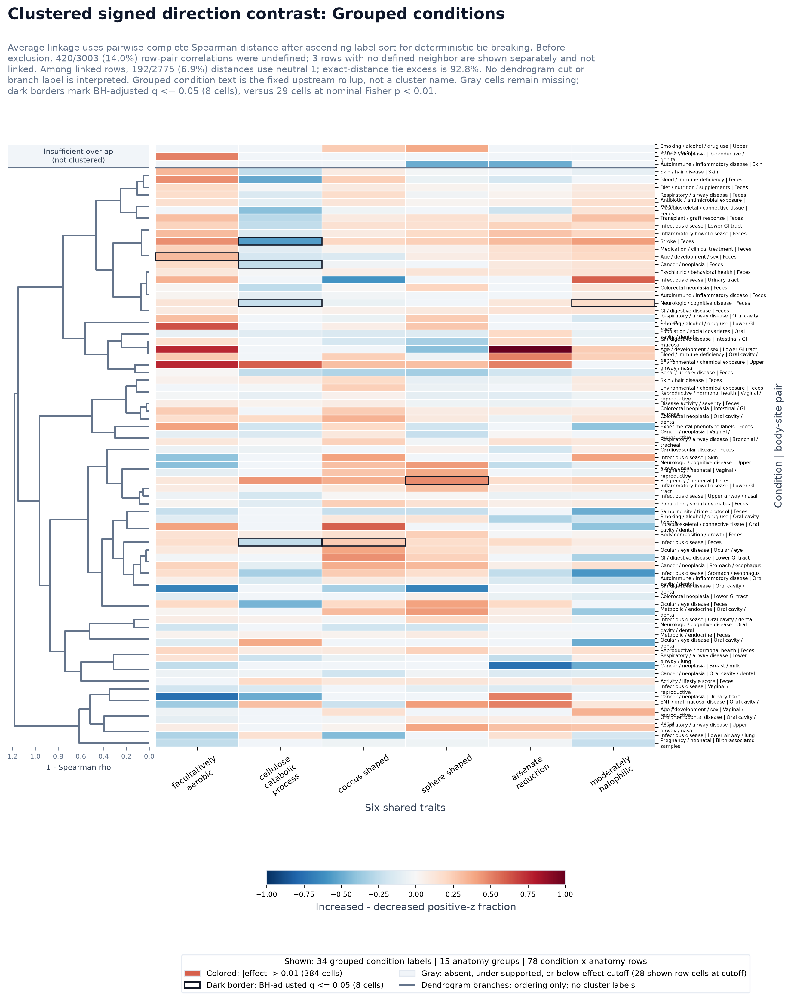
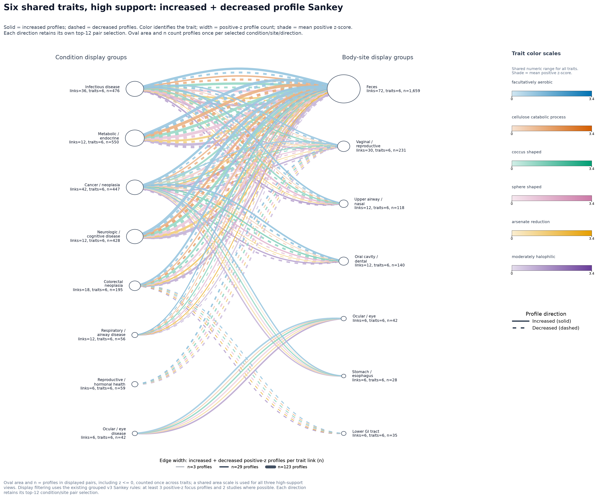

# Six Shared Traits Sankeys

These outputs render the six pooled paired-contrast traits with `q_value <= 0.001` as two combined condition-to-body-site Sankey maps plus readability variants and twelve individual trait-direction Sankey maps.

## Inputs

- Profile counts: `data/derived/study_trait_profiles_wide.tsv`
- Human profile metadata: `trait-visualization/study_trait_profile_study_metadata.tsv`
- Paired trait statistics: `trait-visualization/trait-profile-investigation/trait_profile_paired_contrast_trait_stats.tsv`

## Scoring

For each trait, raw KG-Microbe trait counts were divided by the profile's total trait signal, scaled per 1,000 counts, log1p-transformed, and standardized to z-scores across the human-host profile universe used by the existing study trait profile maps. Each trait is then treated as a one-trait guild.

## Combined Readability Variants

- `combined_direction`: all-edge overlay for one profile direction, with same-color links bundled into one summed trunk per body site.
- `combined_trait_lanes`: option 1; one figure per direction with six stacked trait lanes, preserving all displayed trait-specific links while separating line crossings by trait.
- `combined_shared_high_support`: option 2; one reduced overlay per direction, limited to the top 12 condition/body-site pairs selected from pairs shared by at least 3 traits or with at least 30 positive-z focus profiles.
- `combined_individual_conditions`: one figure per direction with raw individual condition labels on the left and grouped v3 body-site labels on the right. Same-trait records from one condition into one body-site group are summed into a single colored link, then bundled into one body-site trunk per trait color.
- `single_trait_direction`: individual one-trait, one-direction Sankeys.

The combined maps retain the individual trait-direction edge records. Every colored curve in the combined maps is a trait-specific condition/body-site link. The individual maps show one trait and one profile direction per figure. Curve width is the focus-direction positive-z profile count for that trait and shade is the mean positive focus-profile z-score. The overlay maps use the same numeric color range for all six trait-specific monochrome scales. Light grey underlays show the z <= 0 background for the same condition/body-site/trait link. Parallel curves sharing a condition/body-site pair are ordered by edge width from thickest to thinnest. In `combined_direction` and `combined_individual_conditions`, links approaching each body-site node merge into at most six colored trunks, one per trait color scale.

Image node keys spell out the compact labels used in the PNGs: `n=` is positive-z focus-profile support, `s=` is the unique study count for `n`, `bg=` is z <= 0 background-profile support, `links=` is plotted trait-specific link count, and `traits=` is the number of distinct traits represented at a combined-map node.

Node counts are profile-trait memberships across displayed links, not deduplicated profile totals. Use the edge TSVs for exact trait-specific counts, study IDs, raw rolled-up labels, and increased-minus-decreased contrasts.

## Traits

| trait | ID | color | q-value | paired direction | profile count | positive-z profiles |
| --- | --- | --- | ---: | --- | ---: | ---: |
| facultatively aerobic | `METPO:1000608` | `#0072b2` | 2.78e-10 | trait enriched in increased profiles | 5829 | 2971 |
| cellulose catabolic process | `METPO:2000103|GO:0030245` | `#d55e00` | 6.9e-07 | trait enriched in decreased profiles | 5829 | 1847 |
| coccus shaped | `METPO:1000668` | `#009e73` | 1.13e-06 | trait enriched in increased profiles | 5829 | 2689 |
| sphere shaped | `METPO:1000683` | `#cc79a7` | 1.95e-05 | trait enriched in increased profiles | 5829 | 2445 |
| arsenate reduction | `METPO:2000103|pathways:arsenate_reduction` | `#e69f00` | 1.95e-05 | trait enriched in increased profiles | 5829 | 1401 |
| moderately halophilic | `METPO:1000623` | `#6a3d9a` | 3.11e-05 | trait enriched in increased profiles | 5829 | 2648 |

## Outputs

| analysis | type | PNG | displayed trait links | selected pairs | all edge rows |
| --- | --- | --- | ---: | ---: | ---: |
| six_shared_traits_increased | combined_direction | `trait-visualization/trait-profile-investigation/six-shared-traits/six_shared_traits_increased_profile_sankey.png` | 188 |  | 682 |
| six_shared_traits_decreased | combined_direction | `trait-visualization/trait-profile-investigation/six-shared-traits/six_shared_traits_decreased_profile_sankey.png` | 185 |  | 652 |
| six_shared_traits_increased_trait_lanes | combined_trait_lanes | `trait-visualization/trait-profile-investigation/six-shared-traits/six_shared_traits_increased_trait_lanes_profile_sankey.png` | 188 |  | 682 |
| six_shared_traits_decreased_trait_lanes | combined_trait_lanes | `trait-visualization/trait-profile-investigation/six-shared-traits/six_shared_traits_decreased_trait_lanes_profile_sankey.png` | 185 |  | 652 |
| six_shared_traits_increased_shared_high_support | combined_shared_high_support | `trait-visualization/trait-profile-investigation/six-shared-traits/six_shared_traits_increased_shared_high_support_profile_sankey.png` | 72 | 12 | 72 |
| six_shared_traits_decreased_shared_high_support | combined_shared_high_support | `trait-visualization/trait-profile-investigation/six-shared-traits/six_shared_traits_decreased_shared_high_support_profile_sankey.png` | 72 | 12 | 72 |
| six_shared_traits_increased_individual_conditions | combined_individual_conditions | `trait-visualization/trait-profile-investigation/six-shared-traits/six_shared_traits_increased_individual_conditions_profile_sankey.png` | 117 |  | 2001 |
| six_shared_traits_decreased_individual_conditions | combined_individual_conditions | `trait-visualization/trait-profile-investigation/six-shared-traits/six_shared_traits_decreased_individual_conditions_profile_sankey.png` | 105 |  | 1893 |
| facultatively_aerobic_increased | single_trait_direction | `trait-visualization/trait-profile-investigation/six-shared-traits/facultatively_aerobic_increased_profile_sankey.png` | 32 |  | 126 |
| facultatively_aerobic_decreased | single_trait_direction | `trait-visualization/trait-profile-investigation/six-shared-traits/facultatively_aerobic_decreased_profile_sankey.png` | 32 |  | 123 |
| cellulose_catabolic_process_increased | single_trait_direction | `trait-visualization/trait-profile-investigation/six-shared-traits/cellulose_catabolic_process_increased_profile_sankey.png` | 29 |  | 89 |
| cellulose_catabolic_process_decreased | single_trait_direction | `trait-visualization/trait-profile-investigation/six-shared-traits/cellulose_catabolic_process_decreased_profile_sankey.png` | 26 |  | 87 |
| coccus_shaped_increased | single_trait_direction | `trait-visualization/trait-profile-investigation/six-shared-traits/coccus_shaped_increased_profile_sankey.png` | 32 |  | 123 |
| coccus_shaped_decreased | single_trait_direction | `trait-visualization/trait-profile-investigation/six-shared-traits/coccus_shaped_decreased_profile_sankey.png` | 32 |  | 118 |
| sphere_shaped_increased | single_trait_direction | `trait-visualization/trait-profile-investigation/six-shared-traits/sphere_shaped_increased_profile_sankey.png` | 32 |  | 121 |
| sphere_shaped_decreased | single_trait_direction | `trait-visualization/trait-profile-investigation/six-shared-traits/sphere_shaped_decreased_profile_sankey.png` | 32 |  | 113 |
| arsenate_reduction_increased | single_trait_direction | `trait-visualization/trait-profile-investigation/six-shared-traits/arsenate_reduction_increased_profile_sankey.png` | 31 |  | 99 |
| arsenate_reduction_decreased | single_trait_direction | `trait-visualization/trait-profile-investigation/six-shared-traits/arsenate_reduction_decreased_profile_sankey.png` | 31 |  | 90 |
| moderately_halophilic_increased | single_trait_direction | `trait-visualization/trait-profile-investigation/six-shared-traits/moderately_halophilic_increased_profile_sankey.png` | 32 |  | 124 |
| moderately_halophilic_decreased | single_trait_direction | `trait-visualization/trait-profile-investigation/six-shared-traits/moderately_halophilic_decreased_profile_sankey.png` | 32 |  | 121 |

## Cytoscape Graph Explorer

- Interactive graph explorer: `six_shared_traits_profile_graphs.html`
- Inline graph data audit copy: `six_shared_traits_profile_graph_data.json`
- Graph manifest: `six_shared_trait_graph_manifest.tsv`

The graph explorer uses Cytoscape.js from jsDelivr and includes four views: increased/decreased grouped conditions and increased/decreased individual conditions. Each source condition link connects to a trait/body-site bundle node adjacent to its body-site node, then each bundle connects directly to that body-site node. Source and body-site connector widths use separate scales.

| view | condition nodes | body-site nodes | trait/body-site bundles | source edges | body-site connectors |
| --- | ---: | ---: | ---: | ---: | ---: |
| Increased, grouped conditions | 19 | 15 | 73 | 188 | 73 |
| Decreased, grouped conditions | 17 | 14 | 71 | 185 | 71 |
| Increased, individual conditions | 23 | 12 | 50 | 117 | 50 |
| Decreased, individual conditions | 23 | 11 | 52 | 105 | 52 |

## Static Cytoscape-Inspired PNG Graphs

- Manifest: `six_shared_trait_static_graph_manifest.tsv`

These PNGs are graph versions of the six shared trait Sankey views. They use six central trait hubs rather than condition-to-body-site flow bands. Trait-to-body-site links accumulate into small colored bundle nodes adjacent to each body site, then connect directly to the corresponding body-site node. Condition-to-trait and trait-to-body-site widths use separate scales.

| view | PNG | condition nodes | trait hubs | body-site nodes | trait/body-site bundles | condition-trait edges | trait-body links | body-site connectors |
| --- | --- | ---: | ---: | ---: | ---: | ---: | ---: | ---: |
| Increased, grouped conditions | `trait-visualization/trait-profile-investigation/six-shared-traits/six_shared_traits_increased_grouped_cytoscape_hub_graph.png` | 19 | 6 | 15 | 73 | 72 | 73 | 73 |
| Decreased, grouped conditions | `trait-visualization/trait-profile-investigation/six-shared-traits/six_shared_traits_decreased_grouped_cytoscape_hub_graph.png` | 17 | 6 | 14 | 71 | 72 | 71 | 71 |
| Increased, individual conditions | `trait-visualization/trait-profile-investigation/six-shared-traits/six_shared_traits_increased_individual_conditions_cytoscape_hub_graph.png` | 23 | 6 | 12 | 50 | 72 | 50 | 50 |
| Decreased, individual conditions | `trait-visualization/trait-profile-investigation/six-shared-traits/six_shared_traits_decreased_individual_conditions_cytoscape_hub_graph.png` | 23 | 6 | 11 | 52 | 72 | 52 | 52 |

## Condition-Body-Site Cytoscape Heatmaps

- Manifest: `six_shared_trait_cytoscape_heatmap_manifest.tsv`
- Pattern matrix table: `six_shared_trait_condition_body_site_trait_pattern_matrix.tsv`
- Signed contrast table: `six_shared_trait_condition_body_site_direction_contrasts.tsv`
- BH-selected cell table: `six_shared_trait_condition_body_site_bh_selected_cells.tsv`
- Cluster-tree nodes: `six_shared_trait_signed_direction_cluster_tree_nodes.tsv`
- Cluster-tree leaves and row order: `six_shared_trait_signed_direction_cluster_tree_leaves.tsv`
- Individual-versus-grouped comparison: `six_shared_trait_signed_direction_cluster_comparison.tsv`

Trait-pattern heatmaps use the six-shared-trait display-edge TSVs that feed the Cytoscape graph views. Signed contrasts use the full increased and decreased edge TSVs before graph display selection. They preserve condition/body-site/trait records instead of correlating already-collapsed condition and body-site nodes.

Signed contrasts display supported, testable effects above the absolute-effect cutoff, including nonsignificant results. Gray cells are unavailable, under-supported, or at or below the cutoff. Trait-pattern heatmaps continue to mask cells that fail their nominal p-value display threshold.

### How Conditions and Blank Cells Are Chosen

The signed heatmaps do not choose a top-N list of diseases. They read the full increased and decreased Sankey edge tables before graph display selection, discard unknown raw condition labels upstream, and include every condition/body-site row with at least one supported, finite cell whose absolute effect is >0.01. The grouped view applies the v3 clinical condition rollup rules; the individual view keeps the original curated condition label. Both views use the same grouped v3 body-site labels. These are fixed upstream labels, not names inferred from the dendrogram or summaries of every row on a branch.
Grouped conditions are assigned by the ordered, case-insensitive substring rules in `v3_fully_grouped_condition_display_label`; the first matching rule wins and an unmatched label becomes `Other specific clinical labels`. The per-trait `*_profile_sankey_condition_rollups.tsv` files audit every raw condition, displayed label, rule, profile count, and study count. Individual-condition rollup files record that the raw curated label was retained.

The signed contrast table contains candidate edge records, not a complete Cartesian grid. Its exported `blank_reason` is `low positive-z profile or study support` for a present candidate that fails display support and is empty (`NA` in the TSV) for a displayed candidate. A condition/body-site/trait combination for which neither direction emitted a candidate edge is absent from the table rather than assigned a blank reason. In the image, both an absent record and a present under-supported candidate appear gray. A present supported candidate with absolute effect at or below 0.01 has `blank_reason=absolute effect <=0.01` and also appears gray. A direction can have zero positive-z profiles while the cell remains colored when total profiles exist and the other direction meets support. Finite effects above the display cutoff that miss either statistical cutoff remain colored and numbered. In trait-pattern heatmaps only, gray can also mean that the raw one-sided Fisher test did not pass p<0.01.

- `trait_pattern`: Approach 2. Rows are condition/body-site pairs and columns are the six traits. Cell color is Fisher evidence, `-log10(p)`, rendered with a yellow-to-blue sequential palette so darker cells have smaller p-values. Cells require Fisher p<0.01, n>=3, and s>=2 for exploratory display.
- `signed_direction_contrast`: Approach 4. Rows are condition/body-site pairs and columns are traits. Cell color and numbers are `increased_fraction - decreased_fraction` on a fixed -1 to +1 scale. Red favors increased profiles and blue favors decreased profiles. A dark border marks BH-adjusted q<=0.05; the nominal Fisher p<0.01 count is reported separately below. Unbordered cells are descriptive effects. Cells require a finite test, absolute effect >0.01, at least 3 positive-z profiles in either direction, and at least 2 total studies. Every condition/body-site row with a displayed cell is included, without a row cap. Rows are grouped by body site and ranked by nominal-p trait count, coverage, and evidence within each site.
- `signed_direction_contrast_clustered`: A separate compact overview clusters rows with average linkage on pairwise-complete Spearman distance (`1 - rho`). A pairwise correlation requires at least 3 shared supported traits. Blank cells are never filled with zero. Rows are sorted by exact condition/body-site pair label before distance construction so SciPy's tied-distance choices are reproducible. Rows with no defined Spearman distance to any other row are excluded from linkage and shown in a separate `Insufficient overlap (not clustered)` block. Remaining undefined row-pair distances use neutral distance 1. Figure subtitles and the manifest report undefined-pair and exact-distance tie fractions. No dendrogram cut, cluster ID, or branch label is interpreted. A branch would only be named after a predeclared, multiplicity-adjusted enrichment analysis supported such a label; no such label is shown here. Trait columns remain in the fixed six-trait order.
- Readable pages contain at most 24 rows each. `six_shared_trait_signed_direction_heatmap_pages.tsv` records their paths and counts; `heatmap_page` in the contrast table locates each displayed row. The original PNGs show full overviews.
- BH q-values are computed within each heatmap view. `selected_after_bh=True` marks supported cells with q<=0.05; those cells receive the dark border and are also collected in the BH-selected cell table. `nominal_p_value_selected` is the explicit nominal flag; `significant_in_heatmap` is retained as a deprecated compatibility alias.
- The Fisher tables count profiles, not independent studies. A BH-bordered cell is therefore a profile-level diagnostic and does not establish study-level replication.
- Issue #256 / PR #257 adds pooled, denominator-harmonized, study-weighted fraction and log-ratio quantities, but no condition-by-anatomy replacement for this heatmap. Those pooled quantities are therefore not mixed into this profile-level positive-z prevalence contrast; the estimands and sampling units remain explicitly separate.

| heatmap | type | full/ranked PNG | clustered PNG | displayed cells | nominal p<0.01 cells | BH-selected cells | tested cells | rows | condition labels | anatomy groups |
| --- | --- | --- | --- | ---: | ---: | ---: | ---: | ---: | ---: | ---: |
| Increased, grouped conditions | trait_pattern | `trait-visualization/trait-profile-investigation/six-shared-traits/six_shared_traits_increased_grouped_condition_body_site_trait_pattern_heatmap.png` |  | 15 | 15 | 5 | 188 | 9 |  |  |
| Decreased, grouped conditions | trait_pattern | `trait-visualization/trait-profile-investigation/six-shared-traits/six_shared_traits_decreased_grouped_condition_body_site_trait_pattern_heatmap.png` |  | 6 | 6 | 4 | 185 | 6 |  |  |
| Increased, individual conditions | trait_pattern | `trait-visualization/trait-profile-investigation/six-shared-traits/six_shared_traits_increased_individual_conditions_condition_body_site_trait_pattern_heatmap.png` |  | 4 | 4 | 2 | 117 | 2 |  |  |
| Decreased, individual conditions | trait_pattern | `trait-visualization/trait-profile-investigation/six-shared-traits/six_shared_traits_decreased_individual_conditions_condition_body_site_trait_pattern_heatmap.png` |  | 5 | 5 | 4 | 105 | 5 |  |  |
| Grouped conditions: signed direction contrast | signed_direction_contrast | `trait-visualization/trait-profile-investigation/six-shared-traits/six_shared_traits_grouped_condition_body_site_signed_direction_contrast_heatmap.png` | `trait-visualization/trait-profile-investigation/six-shared-traits/six_shared_traits_grouped_condition_body_site_signed_direction_contrast_clustered_heatmap.png` | 384 | 29 | 8 | 747 | 78 | 34 | 15 |
| Individual conditions: signed direction contrast | signed_direction_contrast | `trait-visualization/trait-profile-investigation/six-shared-traits/six_shared_traits_individual_conditions_condition_body_site_signed_direction_contrast_heatmap.png` | `trait-visualization/trait-profile-investigation/six-shared-traits/six_shared_traits_individual_conditions_condition_body_site_signed_direction_contrast_clustered_heatmap.png` | 567 | 21 | 4 | 2379 | 123 | 105 | 12 |

### Clustered Direction Overviews

The grouped view is previewed below. The 123-row individual view is linked directly because a page-width thumbnail is illegible. Use the ranked pages below when numeric annotations need to be read.

#### Grouped conditions: signed direction contrast

#### Individual conditions: signed direction contrast

[Open the full-resolution clustered heatmap](six_shared_traits_individual_conditions_condition_body_site_signed_direction_contrast_clustered_heatmap.png).

### Clustering Diagnostics

The undefined fraction covers every candidate row pair before low-information rows are excluded. Tie excess is `(linkage pairs - distinct distances) / linkage pairs`; it is zero only when every linkage distance is unique.

| view | rows linked | insufficient-overlap rows | undefined candidate pairs | candidate tie excess | undefined linkage pairs | linkage tie excess |
| --- | ---: | ---: | ---: | ---: | ---: | ---: |
| Grouped conditions: signed direction contrast | 75 | 3 | 420/3003 (14.0%) | 2802/3003 (93.3%) | 192/2775 (6.9%) | 2574/2775 (92.8%) |
| Individual conditions: signed direction contrast | 108 | 15 | 2097/7503 (27.9%) | 6927/7503 (92.3%) | 372/5778 (6.4%) | 5202/5778 (90.0%) |

### Signed Direction Pages

- [Grouped conditions, page 1](six_shared_traits_grouped_condition_body_site_signed_direction_contrast_heatmap_page_01.png) (24 rows, 136 filled cells)
- [Grouped conditions, page 2](six_shared_traits_grouped_condition_body_site_signed_direction_contrast_heatmap_page_02.png) (24 rows, 118 filled cells)
- [Grouped conditions, page 3](six_shared_traits_grouped_condition_body_site_signed_direction_contrast_heatmap_page_03.png) (24 rows, 104 filled cells)
- [Grouped conditions, page 4](six_shared_traits_grouped_condition_body_site_signed_direction_contrast_heatmap_page_04.png) (6 rows, 26 filled cells)
- [Individual conditions, page 1](six_shared_traits_individual_conditions_condition_body_site_signed_direction_contrast_heatmap_page_01.png) (24 rows, 139 filled cells)
- [Individual conditions, page 2](six_shared_traits_individual_conditions_condition_body_site_signed_direction_contrast_heatmap_page_02.png) (24 rows, 137 filled cells)
- [Individual conditions, page 3](six_shared_traits_individual_conditions_condition_body_site_signed_direction_contrast_heatmap_page_03.png) (24 rows, 100 filled cells)
- [Individual conditions, page 4](six_shared_traits_individual_conditions_condition_body_site_signed_direction_contrast_heatmap_page_04.png) (24 rows, 96 filled cells)
- [Individual conditions, page 5](six_shared_traits_individual_conditions_condition_body_site_signed_direction_contrast_heatmap_page_05.png) (24 rows, 89 filled cells)
- [Individual conditions, page 6](six_shared_traits_individual_conditions_condition_body_site_signed_direction_contrast_heatmap_page_06.png) (3 rows, 6 filled cells)

### Largest Individual-versus-Grouped Pattern Differences

These are the ten largest finite `1 - rho` distances among rows with at least 5 shared supported traits, not a formal biological outlier test. Lower-overlap rows remain in the complete table but are ineligible for ranks and diagnostic flags. Each individual row is compared with a grouped aggregate that includes that row, so the comparison is not independent; a one-contributor aggregate is the same source row at the broader label. The complete table records contributor counts, within-group IQR flags, and each row's nearest Spearman neighbor.

| individual condition | grouped condition | body site | shared traits | group contributors | rho | distance | discordant | IQR outlier |
| --- | --- | --- | ---: | ---: | ---: | ---: | --- | --- |
| Polycystic ovary syndrome | Metabolic / endocrine | Feces | 6 | 7 | -0.657 | 1.657 | True | False |
| Cesarean section | Pregnancy / neonatal | Feces | 5 | 2 | -0.410 | 1.410 | True | False |
| Socioeconomic status | Population / social covariates | Feces | 5 | 3 | -0.400 | 1.400 | True | False |
| Endometriosis | Reproductive / hormonal health | Vaginal / reproductive | 5 | 3 | -0.264 | 1.264 | True | False |
| Constipation | GI / digestive disease | Feces | 6 | 6 | -0.203 | 1.203 | True | False |
| Breast cancer | Cancer / neoplasia | Feces | 5 | 7 | -0.100 | 1.100 | True | True |
| Bacterial vaginosis | Reproductive / hormonal health | Vaginal / reproductive | 6 | 3 | -0.091 | 1.091 | True | False |
| COVID-19 | Infectious disease | Upper airway / nasal | 6 | 1 | -0.086 | 1.086 | True | False |
| Chronic constipation | GI / digestive disease | Feces | 6 | 6 | 0.029 | 0.971 | False | False |
| Colorectal adenoma | Colorectal neoplasia | Feces | 5 | 3 | 0.051 | 0.949 | False | False |

## Increased and Decreased High-Support Overlay

Solid colored curves show increased profiles and dashed colored curves show decreased profiles. Both run from condition to body site; the line style describes the profile direction, not a negative trait z-score. A colored curve represents positive-z support for one trait in one direction. Hue identifies the trait, width encodes its positive-z profile count, and shade encodes its mean positive z-score on a shared numeric scale.

The top 12 pairs are selected independently for each direction using the same rules as the separate high-support plots. Their union is displayed without combining increased and decreased counts. A missing direction means that link was not selected for display, not necessarily that its support is zero. Oval area and node n count all profiles in selected condition/site/direction cells once across traits, including z <= 0. The three high-support views share one area scale. Curves within each pair are spaced by stroke width, and decreased curves have seven-point strokes separated by nine-point gaps. Grey background underlays are omitted for readability; background counts remain in the tables.

- Displayed links and direction: `six_shared_traits_combined_shared_high_support_profile_sankey_display_edges.tsv`
- All edges for selected direction/pair keys: `six_shared_traits_combined_shared_high_support_profile_sankey_edges.tsv`
- Pair ranks within each direction: `six_shared_traits_combined_shared_high_support_profile_sankey_selected_pairs.tsv`

Regenerate this overlay from the existing grouped Sankey edge tables with `just six-shared-trait-combined-sankey`. Redraw all three saved high-support selections with `just six-shared-trait-high-support-sankeys`; that recipe also exports `_nodes.tsv` tables recording profile totals and oval radii. Analytical edge and pair-selection tables are preserved.
